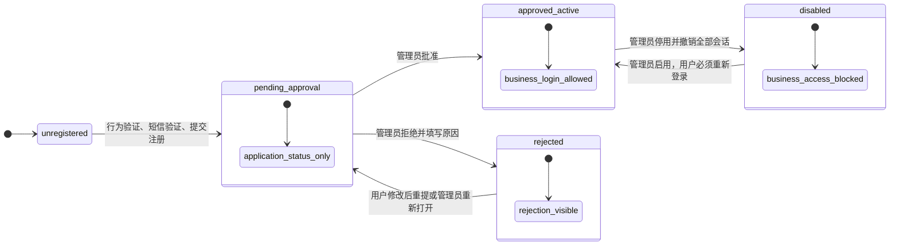
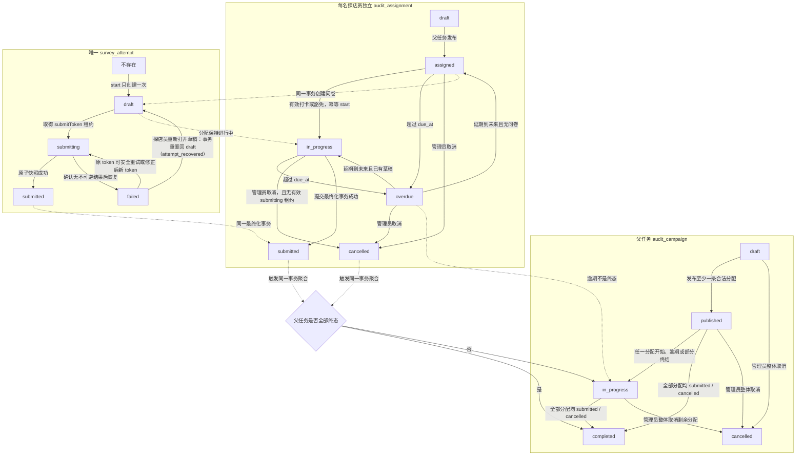
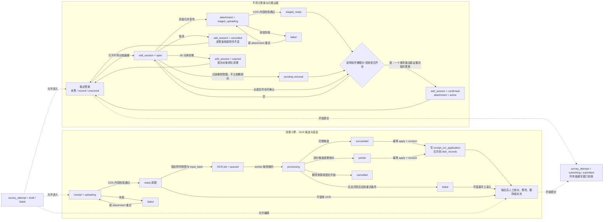
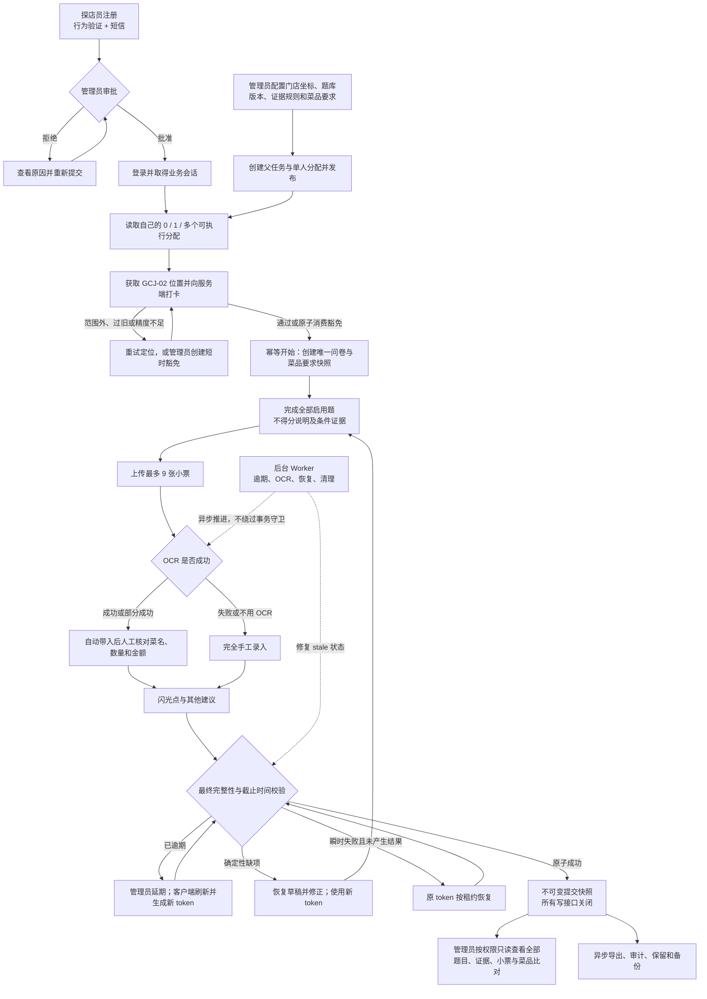

# 暗访问卷状态机总览

> 文档性质：跨角色、跨模块的统一可视化索引。  
> 作用：帮助产品、前端、后端、测试和运维快速理解状态及守卫。  
> 约束：本文件不创建新的字段或 API；发生文字差异时，业务边界以 `project_boundary.md` 为准，业务状态与所有权以 `assignment_spec.md` 为准，接口以 `packages/contracts/endpoint-registry.js` 为准，后端事务与存储以 `BACKEND_DESIGN.md` 为准。  
> 2026-08-10 全栈收口确认：本轮实现未引入任何新状态或新转换，四张状态图与当前代码（账号/父任务/分配/问卷/证据/OCR）一致，无漂移。

## 0. 阅读约定

- 图中的英文是数据库或共享契约状态；中文是用户可理解的动作或守卫。
- 实线箭头表示允许的状态转换；没有画出的箭头一律不允许靠客户端自行跳转。
- `revision` 负责阻止并发覆盖，`Idempotency-Key` / `submitToken` 负责安全重试，两者不能互相替代。
- 账号、父任务、单人分配、问卷实例、编辑会话、附件和 OCR job 是不同聚合，不允许把一个对象的状态直接写进另一个对象。
- 所有时间、权限、所有权、距离、证据完整性和提交完整性都由服务端再次校验。

## 1. 账号与访问状态

关键守卫：

- `pending_approval` 和 `rejected` 只能得到申请状态会话，不能访问任务和问卷。
- `rejected` 不能直接变为 `approved_active`，必须重新进入待审批。
- 停用在同一事务中增加 `session_version` 并撤销现有会话；启用不会恢复旧会话。
- 忘记密码是凭据流程，不新增账号状态：行为验证 → 短信验证码（最多错误 3 次）→ 单次 reset token → 重置密码并撤销旧会话。重置密码不会绕过待审批、拒绝或停用状态。（2026-08-13：小程序端 UI 入口已隐藏，后端流程保留。）后端可通过 AUTH_SELF_SERVICE=disabled 使相关接口休眠（503），启用自助注册/找回时须置 enabled 并配齐密钥。

## 2. 父任务、单人分配与问卷提交状态

关键守卫：

- 不存在 `overdue → submitted`；管理员必须先延期，客户端刷新 `revision` 并生成新 `submitToken`。
- 同一分配最多一个 `survey_attempt`；重复开始返回原实例。
- 提交进入 `submitting` 后，答案、证据、菜品、小票和 OCR 应用全部停止写入。
- 成功提交后只有管理员只读查看；第一阶段探店员不能回看或修改。
- 同一父任务下的分配数据仍完全隔离，但状态变化会短暂串行锁定同一父任务行以安全更新聚合状态。
- `failed` 不是死局：worker 租约过期把 `submitting` 置为 `failed` 后，探店员重新打开草稿会在同一事务内重置回 `draft`（清空提交租约并写 `attempt_recovered` 审计）；提交接口亦视 `failed` 同 `draft`，可直接重新发起提交。

## 3. 问题证据、小票 OCR 与人工校对状态

关键守卫：

- `unscored` 永远要求非空问题说明；题库若要求图片或音频，对应类型至少一份 `active` 证据。
- `cancel`/`expired` 不删除原答案或原附件；只清理本次会话产生的暂存对象。
- OCR job 的终态仍是 `succeeded | partial | failed | cancelled`；“已应用”由独立 application 记录表达，不能篡改 OCR 原始候选。
- OCR 永远不能直接覆盖管理员要求行或人工新修改；`apply` 通过 `revision` 冲突要求刷新。
- 小票最多 9 张的计数、同文件去重和上传完成都由服务端事务再次校验。

## 4. 端到端整体流程

## 5. 并发阅读提示

- 不同父任务、不同分配和不同问卷可以并行处理。
- 同一问卷只有一个业务所有者；重复设备请求通过 `revision`、唯一约束和幂等键裁决，不做多人合并。
- 同一父任务下多个分配同时开始、提交或取消时，会短暂竞争父任务聚合行；这是保证父任务统计一致性的有界串行点，不代表答案数据共享。
- 管理员与探店员同时操作同一资源时，状态守卫和锁顺序为：`idempotency → campaign → assignment → attempt → edit_session/OCR job → UUID 排序的子项`。
- 外部短信、验证码、COS 和 PaddleOCR 调用不得发生在持有数据库事务锁期间。
- “支持并发”必须同时通过数据库竞争测试和目标环境压测，不能仅凭图或代码评审宣称。
