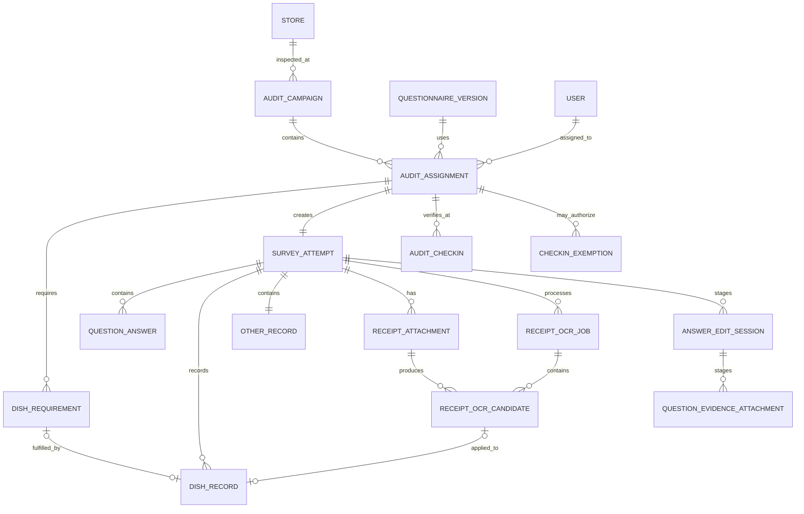

# 探店任务分配与独立问卷规范

## 1. 文档目的

本文档定义管理员如何把“探店员、门店、问卷版本、必点菜品和执行要求”组合成可执行任务，以及多人同时探同一家门店时的数据隔离、权限和并发规则。

本规范是强制业务规范，与以下文件配套使用：

- `project_boundary.md`：项目、角色、权限和交付边界。
- `video_replication_spec.md`：暗访问卷页面、28 个 User Case、视频交互和正式新增流程。
- `IMPLEMENTATION_PLAN.md`：数据库、API、前端、测试和部署步骤。
- `BACKEND_DESIGN.md`：后端事务、锁顺序、存储、OCR 和并发容量门槛。
- `STATE_MACHINE_OVERVIEW.md`：本规范状态的四张统一可视化图，不新增业务规则。

## 2. 永久不可违反的规则

### 2.1 一份问卷永远只能由一个探店员编辑

- 每个任务分配记录只能绑定一个探店员。
- 每个任务分配记录只能生成一个当前有效问卷实例。
- 每个问卷实例只有一个所有者。
- 只有该所有者可以创建、读取草稿、修改答案和最终提交。
- 管理员、其他探店员、复核人员和门店负责人都不能代替所有者编辑原问卷。
- 系统永远不提供共同编辑、共享草稿、多人填写同一问卷或问卷参与者功能。
- 该规则在第一阶段和所有后续阶段保持不变，不属于可选能力。

### 2.2 同一门店可以同时被多人检查，但必须产生独立问卷

允许：

```text
父任务 A：检查餐厅 A
├── 分配 A-1：探店员 A → 问卷实例 A-1
└── 分配 A-2：探店员 B → 问卷实例 A-2
```

禁止：

```text
父任务 A：检查餐厅 A
└── 问卷实例 A-1 ← 探店员 A 和探店员 B 同时编辑
```

A、B 可以使用相同问卷模板和题库版本，也可以在同一时间检查同一家店，但答案、菜品记录、附件、提交 token、提交时间和审计记录必须完全独立。

### 2.3 管理员只能分配和查看，不能代填

- 管理员可以创建、调整和取消尚未开始的分配。
- 分配开始后，管理员不能把已有草稿直接转给另一个探店员。
- 需要换人时，管理员必须取消原分配并创建新分配；原分配和操作原因保留。
- 管理员可以查看已提交问卷，但不能修改原始答案。
- 需要修正时只能发起受控修改版本，并仍由原探店员修改和重新提交。

## 3. 领域对象关系



### 3.1 父任务 `audit_campaigns`

表示一次门店检查计划，用来把多名探店员的独立分配归在一起。

核心字段：

```text
id
name
store_id
starts_at
due_at
status: draft | published | in_progress | completed | cancelled
common_instruction
created_by
created_at
updated_at
published_by
published_at
completed_at
cancelled_by
cancelled_at
cancel_reason
revision
```

父任务不直接拥有问卷答案，也不直接绑定唯一探店员。

父任务状态是持久化的聚合状态，不由前端临时推断：

- `draft`：尚未发布。
- `published`：已发布，且所有分配仍为 `assigned`。
- `in_progress`：至少一条分配已开始、已提交、已取消或已逾期，但仍存在 `assigned | in_progress | overdue` 分配；存在逾期分配时父任务仍为 `in_progress`，列表另显示逾期数量。
- `completed`：父任务未被整体取消，且所有分配都进入 `submitted | cancelled` 终态；`overdue` 不是终态，不能使父任务完成。
- `cancelled`：管理员明确取消父任务。取消事务锁定父任务和全部非终态分配，将 `assigned | in_progress | overdue` 统一转为 `cancelled`；已提交分配保持不变，草稿和审计保留。

第一条分配从 `assigned` 进入 `in_progress` 时，父任务同步进入 `in_progress`。发布、开始、提交、取消、延期和逾期推进事务都必须在同一事务中重算并持久化父任务状态、增加 `revision`。每分钟状态推进任务负责修复没有请求触发的逾期状态，并运行同一个聚合函数；后台查询只读取该持久化状态和实时计数。管理员整体取消必须填写原因，`completed | cancelled` 父任务不能再次取消或恢复。

门店由 `stores` 提供打卡基准，至少包含：

```text
latitude_gcj02
longitude_gcj02
checkin_radius_meters         # 默认 300，按门店在 100–1000 米内配置
accuracy_allowance_max_meters # 默认且最大建议值 200
location_verified_at
location_verified_by
```

经纬度必须使用 GCJ-02，与微信小程序定位结果保持同一坐标系。门店坐标或半径变更必须写审计日志；已开始任务继续使用开始时的门店定位配置快照，避免管理员修改坐标改变历史判断。

### 3.2 任务分配 `audit_assignments`

表示管理员给某一个探店员的具体执行要求。

核心字段：

```text
id
campaign_id
inspector_id
questionnaire_version_id
task_type: secret | overt
status: draft | assigned | in_progress | submitted | overdue | cancelled
starts_at
due_at
budget_limit
receipt_required
special_instruction
created_by
created_at
updated_at
assigned_by
assigned_at
started_at
submitted_at
revision
checked_in_at
checkin_id
```

强制约束：

```text
UNIQUE (campaign_id, inspector_id)
```

如果业务需要同一探店员在同一个父任务中执行两次，必须创建两个不同父任务或明确不同 visit sequence，不能绕过唯一约束复用同一分配。

只有账号状态为 `approved_active` 且手机号已验证的探店员可以被选入新分配。账号待审批、被拒绝或停用时，发布检查必须失败；账号在任务发布后被停用时，不允许开始新问卷。（2026-08-13 策略调整：小程序端自助注册/找回密码 UI 已隐藏，后端注册 API 与本节发布检查规则保持不变。）

`task_type` 是任务分配的必填持久化字段，问卷实例从分配复制该值作为不可变快照。第一阶段只实现 `secret` 暗访流程：管理员可以保存 `overt` 明察草稿用于后续配置，但当前功能开关未启用时发布检查必须拒绝明察分配，不能把它当作暗访问卷执行。

### 3.2.1 现场打卡 `audit_checkins`

开始问卷前必须创建服务端校验的现场打卡记录：

```text
id
assignment_id
inspector_id
captured_at
latitude_gcj02
longitude_gcj02
accuracy_meters
distance_to_store_meters
base_radius_meters
accuracy_allowance_meters
effective_radius_meters
result: accepted | outside_radius | stale | low_accuracy | rejected
valid_until
consumed_at
created_at
```

校验规则：

- 小程序登录后首次进入业务页申请一次定位；点击“开始探店”时必须重新定位，不能复用超过 60 秒的启动定位。
- 客户端请求提交原始经纬度、精度和采样时间；服务端从任务关联门店读取坐标并使用 Haversine 等确定算法重新计算直线距离。
- `accuracy_allowance_meters = min(accuracy_meters, accuracy_allowance_max_meters)`；只有 `accuracy_meters <= accuracy_allowance_max_meters` 且 `distance <= base_radius + accuracy_allowance` 才能通过。
- 商场室内误差通过基础半径和最多 200 米精度补偿处理，不能因精度极差无限放大允许范围。
- 拒绝授权、定位失败、样本过旧、精度过差或范围外都不能开始；允许重新定位。确需例外时由管理员创建有原因、有时效、有审计的单次打卡豁免，客户端不能自行绕过。
- 一次通过的打卡只对应当前分配。不得把一个门店或一个任务的打卡复用于另一分配。
- 通过记录默认 5 分钟内可用于首次创建问卷，并在首次成功开始时标记 `consumed_at`。问卷已创建后，幂等的开始操作可以返回原实例，不要求重复打卡；尚未开始且打卡过期时必须重新定位。

### 3.2.2 打卡豁免 `checkin_exemptions`

打卡豁免只用于设备定位确实不可用的单次异常，不是普通开始方式。

```text
id
assignment_id
reason
status: active | consumed | revoked | expired
granted_by
granted_at
valid_until
consumed_at
consumed_attempt_id
revoked_by
revoked_at
revoke_reason
revision
```

强制规则：

- 只有具有 `checkin:exempt` 权限、且数据范围覆盖该门店的超级管理员或运营管理员可以创建/撤销；探店员、复核人员和门店负责人均不能操作。
- 仅 `assigned` 且处于有效时间窗口、尚未创建问卷的分配可以创建豁免；`submitted`、`cancelled`、`overdue` 或已有问卷的分配禁止创建。
- `reason` 必填，`valid_until` 必须晚于当前时间且最长不超过 30 分钟。
- PostgreSQL 使用部分唯一索引保证每个分配最多一个 `status='active'` 的豁免，并用基于授权时间的确定性检查限制有效期：

```sql
CREATE UNIQUE INDEX uq_checkin_exemptions_one_active
  ON checkin_exemptions (assignment_id)
  WHERE status = 'active';

ALTER TABLE checkin_exemptions
  ADD CONSTRAINT ck_checkin_exemption_window
  CHECK (valid_until > granted_at
         AND valid_until <= granted_at + INTERVAL '30 minutes');
```
- 撤销只允许 `active -> revoked`；过期任务将 `active -> expired`；两者都不能恢复或消费。
- 创建、查询和开始问卷事务都先锁定当前分配，并把该分配下 `status='active' AND valid_until <= now()` 的豁免原子推进为 `expired`，再检查部分唯一索引或选择可消费记录；每分钟过期任务只负责减少延迟，正确性不能依赖后台任务及时运行。
- 开始问卷事务先取得不可变 `campaign_id`，再按 `campaign → assignment → survey_attempt → 候选豁免` 锁定。只有一个并发请求可以把 `active` 原子改为 `consumed` 并写入 `consumed_attempt_id`；事务回滚时豁免消费也回滚。
- 创建、消费、撤销和过期均写审计日志。管理员 UI 只显示业务原因、有效期和中文状态。

### 3.3 必点菜品 `assignment_dish_requirements`

管理员可以为每个探店员单独指定需要点的菜。不同探店员可以被要求点不同菜，用于扩大检查覆盖面。

核心字段：

```text
id
assignment_id
sort_order
dish_name
quantity
required
allow_substitution
max_unit_price
instruction
```

字段规则：

- `dish_name`：管理员要求点的菜名，采用文本录入，不依赖 POS 或库存系统。
- `quantity`：要求数量，默认 1。
- `required`：必点或建议点。
- `allow_substitution`：售罄时是否允许替换。
- `max_unit_price`：可选预算限制。
- `instruction`：例如“观察上菜时间”“检查温度”“不要主动提醒服务员”。

菜品完成规则：

- `required=true` 的必点菜品必须记录 `ordered | substituted | unavailable` 之一，不能跳过。
- `required=false` 的建议菜品可以记录 `skipped`；如果实际点了，则按普通已点菜品校验。
- `ordered`：`actual_name` 必填；`substitution_reason` 和 `unavailable_reason` 为空。
- `substituted`：只有 `allow_substitution=true` 才允许；`actual_name` 和 `substitution_reason` 必填。
- `unavailable`：`actual_name` 必须为空，`unavailable_reason` 必填，评价和满意状态不适用。
- `skipped`：仅建议菜品允许；`actual_name` 为空，评价和满意状态不适用。
- `extra`：`requirement_id` 为空且 `actual_name` 必填。
- 对 `ordered | substituted | extra`，必须满足“`fully_satisfied=true`”或“非空 `evaluation`”至少一项。满意图标再次点击会取消；取消后若评价为空，该菜品立即变为未完成。

### 3.3.1 消费小票、OCR 候选与最终菜品

消费小票归属整份 `survey_attempt`，不归属题目或单个菜品。小票原图是审计事实；OCR 只产生可编辑候选，不能直接改变评分或覆盖管理员的菜品要求。

`receipt_attachments` 核心字段：

```text
id
attempt_id
storage_key
original_file_name
detected_mime_type
size_bytes
sha256
width
height
sort_order
status: uploading | ready | failed | deleted
created_by
created_at
uploaded_at
deleted_at
revision
```

强制规则：

- 每个问卷最多 9 个 `status <> deleted` 的附件；客户端一次选择不得超过剩余名额，服务端在事务中再次计数。
- 同一问卷有效附件使用 PostgreSQL 部分唯一索引阻止完全相同文件重复上传：

```sql
CREATE UNIQUE INDEX uq_receipt_attachment_attempt_sha_active
  ON receipt_attachments (attempt_id, sha256)
  WHERE status <> 'deleted';
```

- `uploading | failed` 附件可由用户删除；超过 24 小时未完成的上传由幂等清理任务转为删除并清理孤立对象，不能永久占用 9 张名额。
- `storage_key` 由服务端随机生成，客户端不能指定；只有文件签名、大小、校验和和对象归属校验成功后才能进入 `ready`。
- `receipt_required=true` 只要求至少一个当前问卷的 `ready` 原图，不要求 OCR 成功。

`receipt_ocr_jobs` 核心字段：

```text
id
attempt_id
status: queued | processing | succeeded | partial | failed | cancelled
provider
provider_model
parser_version
input_hash
idempotency_key
request_hash
attempt_count
locked_at
lease_expires_at
started_at
completed_at
sanitized_error_code
created_at
```

同一附件有序集合、文件摘要、供应商模型和解析器版本生成确定性 `input_hash`；相同输入重放同一结果，不重复计费或重复创建菜品。`processing` 使用短时租约、条件接管和有限重试，页面重新打开只能恢复/查询任务，不能自动再次创建收费请求。

`receipt_ocr_candidates` 核心字段：

```text
id
job_id
attachment_id
raw_name
normalized_name
quantity
unit_price_cents
line_total_cents
currency
name_confidence
quantity_confidence
unit_price_confidence
line_total_confidence
source_text
source_bounding_box
sort_order
status: proposed | applied | rejected
created_at
```

每张小票另保存规范化汇总 `subtotal_cents/discount_cents/service_charge_cents/payable_total_cents/calculated_item_total_cents/difference_cents`。金额以整数分保存；数量使用数据库精确数值，不以 JavaScript 二进制浮点作为业务真值。

候选应用规则：

- OCR 原始候选与最终 `dish_records` 分开保存；最终菜品通过可空 `receipt_ocr_candidate_id` 保留来源，人工修改不覆盖候选。
- 可靠匹配管理员要求时只填充对应要求行的实际名称、数量和价格，保留 `requirement_id/planned_name/required/allow_substitution`；歧义项不得自动绑定。
- 未匹配候选创建 `extra`；折扣、服务费、优惠、抹零和支付方式等非菜品项不能创建菜品。
- 重复应用同一 job 必须幂等。应用时锁定问卷并校验菜品草稿 revision；并发修改时返回业务冲突，不静默覆盖。
- 缺少单价或行总价时仅可根据可信数量和另一金额推算，并标记 `price_derived`；无法可靠推算时保持为空并要求人工核对。
- 删除来源小票时，未人工修改且仅来自该图的自动额外菜品可由用户明确选择同步删除；已人工修改、绑定任务要求或有其他来源的菜品必须保留为手工记录或显式确认，不能静默删除。
- `submitting | submitted` 后禁止附件写入、OCR 创建/应用和菜品修改；迟到 OCR 回调只可结束外部任务并进入对账/清理，不能写入提交快照。

### 3.4 问卷实例 `survey_attempts`

问卷实例属于一个任务分配，不直接属于父任务。

核心字段：

```text
id
assignment_id
questionnaire_version_id
mode: secret | overt
status: draft | submitting | submitted | failed
current_category
revision
submit_token
created_at
last_saved_at
submitted_at
```

强制约束：

```text
UNIQUE (assignment_id)
```

`survey_attempts` 不重复保存 `owner_user_id`，避免无法用普通 PostgreSQL `CHECK` 实现的跨表约束。唯一所有者通过不可变关系 `survey_attempts.assignment_id -> audit_assignments.inspector_id` 推导。分配一旦开始就禁止更换 `inspector_id`。

所有答案查询和写入都必须联表校验：

```text
assignment.inspector_id
authenticated_user.id
```

两者不一致时返回禁止访问，不能只凭客户端提交的 `attempt_id` 放行。

### 3.5 不得分临时编辑会话

不得分详情使用 `question_answer_edit_sessions`，避免用户点击取消时原说明或原附件已被提前删除。

```text
id
attempt_id
question_id
base_answer_revision
status: open | confirmed | cancelled | expired
draft_issue_remark
created_at
expires_at
confirmed_at
cancelled_at
```

待删除附件使用关联表而不是数组字段：

```text
question_answer_edit_session_removals
  edit_session_id
  attachment_id
  attempt_id
  question_id
  created_at
```

数据库必须建立以下约束：

```sql
CREATE UNIQUE INDEX uq_answer_edit_session_one_open
  ON question_answer_edit_sessions (attempt_id, question_id)
  WHERE status = 'open';

ALTER TABLE question_answer_edit_sessions
  ADD CONSTRAINT uq_answer_edit_session_identity
  UNIQUE (id, attempt_id, question_id);

ALTER TABLE question_evidence_attachments
  ADD CONSTRAINT uq_question_evidence_identity
  UNIQUE (id, attempt_id, question_id);

ALTER TABLE question_answer_edit_session_removals
  ADD PRIMARY KEY (edit_session_id, attachment_id),
  ADD FOREIGN KEY (edit_session_id, attempt_id, question_id)
    REFERENCES question_answer_edit_sessions (id, attempt_id, question_id),
  ADD FOREIGN KEY (attachment_id, attempt_id, question_id)
    REFERENCES question_evidence_attachments (id, attempt_id, question_id);
```

关联表只能引用同一问卷、同一题目的现有 `active` 附件。

- 打开详情时创建会话并读取当前已提交到草稿的说明和 `active` 附件作为基线；一个用户对同一题最多一个 `open` 会话。
- 新文件初始化为 `staged_uploading`，服务端完成校验后变为 `staged_ready`，并绑定编辑会话；删除原附件只写入 `question_answer_edit_session_removals`，不立即修改原附件。
- 创建会话前先把同题已过 `expires_at` 的 `open` 会话原子推进为 `expired`，再插入新会话；部分唯一索引负责阻止两个并发请求同时创建成功。
- 点击确定时，服务端锁定问卷和答案，校验 `base_answer_revision`、说明和证据要求，在一个事务内把新附件从 `staged_ready` 提升为 `active`、把移除项标记 `deleted`、更新答案并关闭会话。
- 点击取消只把会话置为 `cancelled`，原答案和原附件保持不变；该会话新上传的 `staged_uploading | staged_ready` 对象进入异步清理队列。
- 未关闭会话 30 分钟过期；过期和取消会话的暂存对象最迟 24 小时内从对象存储删除。
- 问卷进入 `submitting` 或 `submitted` 后，创建/更新/确认/取消编辑会话、上传初始化、上传完成、附件删除及其他相关写操作全部拒绝。提交事务只快照 `active` 附件；迟到的上传完成回调不得改变原始提交，只能进入孤立对象清理。

## 4. 管理员分配内容

管理员为每一个探店员创建分配时必须或可以填写以下信息：

### 4.1 必填信息

- 探店员。
- 门店。
- 问卷模板和已发布版本。
- 允许开始时间。
- 截止时间。
- 暗访或明察任务类型。

### 4.2 菜品要求

- 必点菜品名称。
- 数量。
- 是否必点。
- 是否允许替代。
- 替代时需要填写的原因。
- 单品预算或总预算，可选。
- 菜品观察重点。
- 是否必须上传消费小票。
- 小票最多 9 张；OCR 只辅助录入，探店员仍需核对数量和金额。

### 4.3 特别说明

- 到店时间要求。
- 是否允许提前或延后。
- 保密提示。
- 服务观察重点。
- 环境观察重点。
- 菜品观察重点。
- 其他现场要求。

管理员不能在分配中要求项目永久边界之外的 POS、支付、库存或自动处罚能力。

## 5. 管理员创建任务流程

### 5.1 创建父任务

1. 选择门店。
2. 填写任务名称。
3. 设置整体开始和截止时间。
4. 填写所有分配共用的说明。
5. 保存为草稿。

### 5.2 逐人创建分配

1. 选择一名探店员。
2. 选择任务类型 `secret` 暗访或 `overt` 明察。
3. 选择该人员使用的问卷模板和已发布版本。
4. 设置个人执行时间窗口。
5. 添加必点或建议菜品。
6. 设置预算、小票要求和替代规则。
7. 填写个人特别说明。
8. 保存并校验。
9. 为下一名探店员重复以上操作。

### 5.3 发布前检查

系统必须检查：

- 父任务至少包含一条分配。
- 每个分配只有一个探店员。
- 问卷版本已发布且在有效期内。
- 分配时间位于父任务时间窗口内。
- 同一父任务没有重复分配同一个探店员。
- 必点菜品名称、数量和替代规则完整。
- 要求上传小票时，私有存储、上传完成校验和提交守卫已启用；OCR 供应商临时故障不能使已发布任务无法手工完成。
- 探店员处于启用状态并有权执行该区域任务。
- 探店员账号已批准且手机号已验证。
- 门店已配置并校准 GCJ-02 坐标、业务半径和精度补偿上限。
- 每个分配都有持久化任务类型；第一阶段发布内容只能包含 `secret`，发现 `overt` 时返回“明察任务尚未启用”。

### 5.4 发布

1. 父任务从 `draft` 变为 `published`。
2. 各分配从 `draft` 变为 `assigned`。
3. 记录发布人、发布时间和数据快照。
4. 发布后任务出现在各探店员的日程列表；第一阶段不发送站内信、订阅消息或短信通知。
5. 发布后问卷版本冻结。

## 6. 探店员端流程

### 6.1 日程页

视频展示了“日程”底部入口但没有进入页面。根据本规范，日程页用于展示当前用户自己的任务分配，不展示其他探店员的安排。

列表展示：

- 门店名称。
- 允许开始时间和截止时间。
- 任务类型。
- 状态。
- 是否有必点菜品。
- 是否要求消费小票。
- 是否已经完成现场打卡。

底部“问卷”入口永远不读取或写入“全局当前分配”：

- 可执行任务为 0 条：显示空状态，并提供“查看日程”。
- 可执行任务恰好 1 条：进入该任务详情；已有草稿时可直接继续填写。
- 可执行任务超过 1 条：显示任务选择列表，由用户明确选择后以路由参数进入任务详情。
- 路由参数只在当前页面生效；服务端仍按登录用户校验分配归属。返回或切换账号后不得沿用上一次选择。

### 6.2 任务详情页

开始问卷前展示：

- 门店信息。
- 问卷名称和版本。
- 时间窗口。
- 必点菜品及数量。
- 替代规则。
- 预算要求。
- 小票要求。
- 特别说明。

探店员确认后点击“开始探店”，小程序重新获取高精度 GCJ-02 定位并提交服务端校验。只有打卡通过后，系统才为该分配创建或恢复唯一问卷实例。重复点击在同一有效打卡下仍只返回同一问卷实例。

异常提示必须使用业务语言：范围外提示“当前距离门店较远，请到店后重试”；精度过差提示“定位精度不足，请移动到较开阔位置后重试”；拒绝授权提供打开设置入口。页面不得展示经纬度、内部距离公式或接口错误。

### 6.3 问卷页

问卷页面继续严格遵守 `video_replication_spec.md`：环境卫生 1–20、为客服务 21–42、产品品质 43–50，以及得分、不得分、说明、按题库版本要求的图片/音频证据、菜品记录、闪光点、其他建议和最终提交。

每个不得分答案的文本说明固定必填。题库若要求图片、音频或两者，当前题缺少任一种上传成功的必需证据时，点击下一题、离开当前题或进入菜品记录都必须被阻止；服务端保存和最终提交再次校验。

页面不能显示其他探店员的答案、完成度、菜品记录或提交状态。

### 6.4 菜品记录页与管理员要求衔接

- 页面先显示消费小票区域，再显示管理员要求和菜品编辑行；支持一次选择且整份问卷最多 9 张 JPEG/PNG，小程序展示逐张上传进度、预览、失败重试和删除。
- 只有 `ready` 小票可发起 OCR。OCR 以后台任务执行，页面显示识别中、部分成功、失败和重试；失败保留原图和菜品草稿，允许直接手工录入。
- OCR 成功后客户端自动调用幂等应用接口，将候选带入可编辑菜品行；低置信度、缺失或推算字段显示“请核对”，用户可修改、删除或补充。
- 管理员指定的菜品预填为固定要求行。
- 必点菜品行不能直接删除。
- 探店员填写实际点到的菜名；已点菜品必须填写评价或明确标记“全部满意”。
- 允许替代时，探店员可填写替代菜和原因。
- 不允许替代且菜品售罄时，必须记录“未点到”和原因，由管理员后续审核。
- 探店员仍可以使用视频中的“点击添加其他菜品”记录额外菜品。
- 满意图标再次点击取消；评价输入和语音转文字行为保持视频一致。
- 建议菜品可以明确选择“未点”；必点菜品不能使用该状态。
- 消费小票属于整次问卷实例，不属于单个菜品。
- 管理员详情同时只读展示小票短时原图、OCR 原始候选、最终菜品和名称/数量/单价/行总价差异。

建议 `dish_records` 字段：

```text
id
attempt_id
requirement_id: nullable
sort_order
planned_name: nullable
actual_name: nullable
quantity
unit_price_cents: nullable
line_total_cents: nullable
fulfillment_status: ordered | substituted | unavailable | skipped | extra
substitution_reason: nullable
unavailable_reason: nullable
evaluation: nullable
fully_satisfied
source: manual | ocr
receipt_ocr_candidate_id: nullable
manually_modified
price_derived
```

## 7. 权限矩阵

| 动作 | 探店员本人 | 其他探店员 | 运营管理员 | 复核人员 | 门店负责人 |
|---|---:|---:|---:|---:|---:|
| 查看自己的分配 | 允许 | 禁止 | 允许 | 授权时允许 | 授权时允许 |
| 现场打卡 | 允许，仅自己的分配 | 禁止 | 禁止；仅可创建审计豁免 | 禁止 | 禁止 |
| 开始问卷 | 允许 | 禁止 | 禁止 | 禁止 | 禁止 |
| 编辑草稿 | 允许 | 禁止 | 禁止 | 禁止 | 禁止 |
| 上传/删除自己的小票并发起 OCR | 允许，仅草稿且自己的分配 | 禁止 | 禁止 | 禁止 | 禁止 |
| 提交问卷 | 允许 | 禁止 | 禁止 | 禁止 | 禁止 |
| 查看已提交问卷内容、小票和证据 | 禁止；仅看任务状态和提交时间 | 禁止 | 授权时允许 | 授权时允许 | 仅本门店授权结果 |
| 修改原始提交 | 禁止 | 禁止 | 禁止 | 禁止 | 禁止 |
| 取消未开始分配 | 禁止 | 禁止 | 允许 | 禁止 | 禁止 |
| 发起后续更正版本（第二阶段） | 禁止 | 禁止 | 允许 | 授权时允许 | 禁止 |

## 8. 并发和数据隔离

### 8.1 不同分配之间

- A、B 的所有写请求使用不同 `assignment_id` 和 `attempt_id`。
- 答案、证据、菜品和提交快照只锁定当前聚合；需要改变分配状态的事务还会按统一顺序短暂锁定其父任务行、当前分配和问卷。
- 不使用全局当前任务、全局当前问卷或整表锁。
- 不同父任务的分配可完全并行；同一父任务下的状态变化可能短暂竞争父任务聚合行，但不能读取、覆盖或串入另一个分配的数据。
- 同父任务热点、锁等待和容量结论必须通过 `BACKEND_DESIGN.md` 第 19.4 节压测，不能仅凭行锁设计声称支持任意 N。

### 8.2 同一分配的重复请求

- 草稿使用 `revision` 乐观锁。
- 同一答案唯一约束为 `UNIQUE (attempt_id, question_id)`。
- 同一提交 token 重试返回原成功结果。
- 不同 token 对已提交问卷返回冲突。
- 系统不实现多人编辑，因此发现非所有者请求时直接拒绝，不尝试合并。
- 相同小票输入摘要的 OCR 创建返回同一任务/结果；同一 OCR job 重复应用不能重复创建菜品。
- OCR 应用使用菜品 revision 乐观锁；与人工编辑并发时只能一个成功，另一个提示刷新后重试。

### 8.3 管理员并发

- 分配记录使用 `revision` 乐观锁。
- 两名管理员同时修改同一未开始分配时，仅一个版本成功，另一个返回 `409 Conflict`。
- 已开始分配禁止重新绑定探店员或题库版本。

## 9. API 规范

唯一 API 路径、方法和请求/响应契约以 `IMPLEMENTATION_PLAN.md` 第 7 节为准，后端数据库、COS、PaddleOCR、后台任务、安全和运维实现以 `BACKEND_DESIGN.md` 为准。本文件不再维护第二份 endpoint 清单；产品、后端、小程序和管理员端 agent 都必须引用唯一 API 和共享 Zod 契约。

本规范只补充不可被 API 契约削弱的业务条件：

- 必须覆盖父任务创建/列表/详情/修改、草稿分配创建/修改/删除、发布、取消和受控延期。
- 必须覆盖父任务整体取消、题库版本列表/详情，以及从已发布版本复制新草稿；具体路径只以 `IMPLEMENTATION_PLAN.md` 第 7 节为准。
- 必须覆盖打卡、幂等开始，以及打卡豁免的创建、查询和撤销。
- 必须覆盖小票上传初始化/完成/查询/删除、OCR 任务创建/查询/幂等应用，以及管理员小票与菜品差异查看；具体路径只以 `IMPLEMENTATION_PLAN.md` 第 7 节为准。
- 打卡由服务端计算距离；开始同时校验账号、时间窗口和有效打卡/豁免，客户端不能绕过。
- 草稿分配只有在从未发布、没有问卷和没有审计外部引用时才能删除；发布后只能取消。
- 所有写操作都必须使用服务端身份、状态守卫、revision/幂等键和审计，不接受客户端自行声明所有者、账号状态或打卡通过。

分阶段开发不能产生第二套临时业务契约：当前没有产品后端时，前端仍使用 `IMPLEMENTATION_PLAN.md` 第 7 节的正式路径和共享 schema；测试专用 contract server 可以返回受 schema 校验的 fixture，但生产默认 adapter 在 API 不可用时必须失败，不能把 fixture、本地临时文件或浏览器状态当成服务端事实。只有后端所有权、私有上传、OCR job/apply 和提交锁全部接通后，小票/OCR 才能从“前端就绪”进入“业务完成”。

## 10. 管理员界面

### 10.1 父任务列表

展示门店、时间窗口、分配人数、已开始人数、已提交人数、逾期人数和整体状态。

### 10.2 父任务编辑页

分为：

1. 基本信息。
2. 探店员分配表。
3. 每人问卷版本。
4. 每人必点菜品。
5. 预算、小票和特别说明。
6. 发布前检查结果。

### 10.3 探店员分配表

每行代表一名探店员，必须清楚显示：

- 探店员。
- 问卷版本。
- 开始和截止时间。
- 必点菜品数量。
- 小票要求。
- 状态。
- 最后修改人和时间。

禁止在一个表单字段中选择多名探店员并让其共用一个问卷实例。批量操作只能批量创建多条独立分配。

### 10.4 小票与菜品比对

提交详情按数据范围只读展示：

- 最多 9 张小票缩略图和短时授权原图。
- 每张小票的 OCR 状态、原始规范化候选和小票总额。
- 探店员最终菜品的名称、数量、单价、行总价和人工修改标记。
- OCR 与最终值的名称/数量/金额差异、OCR 删除项、人工新增项和总额差异。

页面不得显示 `storage_key`、供应商 request ID、原始错误、内部置信度字段名或 API 路径；管理员没有修改原图、OCR 候选或最终菜品的入口。

### 10.5 任务相关 UI 的业务化显示

探店员端和管理员端都不能直接显示本规范中的工程字段。本规范中的字段名只用于数据库、API 和开发沟通。

| 内部数据 | 用户界面显示 |
|---|---|
| `campaign_id`、`assignment_id`、`attempt_id` | 隐藏；需要识别时显示业务任务编号或任务名称 |
| `inspector_id`、`store_id` | 探店员姓名、门店名称 |
| `questionnaire_version_id` | 问卷名称和业务版本标签 |
| `draft` | 待发布或填写中，按所在业务对象显示 |
| `assigned` | 待开始 |
| `in_progress` | 进行中 |
| `submitted` | 已提交 |
| `overdue` | 已逾期 |
| `cancelled` | 已取消 |
| `revision` | 不显示；冲突时提示“内容已更新，请刷新后重试” |
| HTTP 401/403 | “登录已失效，请重新登录”或“你没有权限进行此操作” |
| HTTP 409 | “内容已更新，请刷新后重试” |
| submit token、幂等键、storage key | 永远不显示 |

禁止把接口错误对象、JSON、堆栈、数据库错误、API 路径或内部枚举直接放进页面、弹窗、Toast、通知或导出文件名。

管理员需要定位问题时，系统在后台日志中记录工程信息；产品 UI 仍只显示业务说明和可执行的下一步。

## 11. 状态转换

分配、问卷、父任务和账号的统一图见 [STATE_MACHINE_OVERVIEW.md](STATE_MACHINE_OVERVIEW.md) 第 1、2 节。本节保留规范性守卫，避免多个文件各自维护重复图而发生漂移。

状态转换必须校验操作者、当前 revision 和业务权限。

`Assigned --> InProgress` 的守卫条件为：账号已批准启用、任务时间有效、存在当前分配的有效打卡或受控豁免。打卡失败不改变分配状态。

第一阶段不允许迟交。提交事务必须按 `campaign → assignment → attempt` 的统一顺序锁定当前聚合，并检查 `status=in_progress` 且服务端当前时间不晚于 `due_at`；如果已过截止时间，原子标记为 `overdue` 并拒绝提交。管理员必须先通过受控延期接口把 `due_at` 调整到未来并填写原因：没有问卷的任务恢复为 `assigned`，已有草稿的任务恢复为 `in_progress`。系统不存在 `overdue -> submitted` 直接转换。

逾期推进采用双保险：每分钟后台任务先分批领取存在到期分配的父任务，再按 UUID 顺序锁定其 `due_at <= now()` 且状态为 `assigned | in_progress` 的分配并转为 `overdue`；禁止先锁分配后反向锁父任务。任务列表/详情、开始、提交、延期和取消事务也先对当前作用域执行同一有序条件更新。转换使用条件更新和唯一审计业务键保证幂等，并在同一事务中重算父任务状态，因此没有后续请求的任务也会在一分钟内持久化为逾期。

提交发现逾期时，本次 submit token 记录为“token 终态失败”，响应明确返回 `requires_new_token=true`。管理员延期不删除或改写旧幂等记录；客户端刷新到新 `assignment.revision` 后必须生成新 token。进程崩溃和瞬时故障不属于该类，可按实施计划的租约恢复规则继续使用原 token。

### 11.1 父任务状态转换

父任务图统一见 [STATE_MACHINE_OVERVIEW.md](STATE_MACHINE_OVERVIEW.md) 第 2 节。

`overdue` 分配仍可由管理员延期或取消，因此不是父任务完成条件。整体取消与逐条取消不同：整体取消明确把父任务置为 `cancelled`；逐条取消后若全部分配均已终结，父任务按聚合规则进入 `completed`。

### 11.2 探店员账号状态转换

账号图统一见 [STATE_MACHINE_OVERVIEW.md](STATE_MACHINE_OVERVIEW.md) 第 1 节。

- 被拒绝账号不能直接从 `rejected` 变为 `approved_active`；必须先重新进入 `pending_approval`，再由另一次审批决定。
- 申请人使用用户名、密码进入受限的申请状态会话，可查看拒绝原因、修改允许字段并重新提交；不能访问任务 API。
- 管理员误操作时可以填写原因把拒绝申请重新打开为待审核，但不能跳过待审核直接批准。
- 停用必须在同一事务中增加用户会话版本并撤销全部现有会话；正在使用的小程序下一次请求立即失效。
- 已发布但未开始的分配保持 `assigned` 并标记“人员不可用”，不能开始；管理员必须取消后新建分配或重新启用原人员。
- 已有草稿的分配不得转让。停用后草稿冻结，只有重新启用原探店员才能继续；管理员也可以取消任务并保留草稿和审计记录。
- 重新启用不恢复旧会话，用户必须重新登录。所有状态转换均使用 revision 并写审计日志。

## 12. 验收标准

### 12.1 永久规则

- 任意问卷实例只有一个所有者。
- 其他探店员即使知道 `attempt_id` 也无法读取或写入。
- 管理员无法编辑原始问卷。
- 系统不存在共同编辑入口、参与者表或共享草稿模式。

### 12.2 同店多人

- 管理员可以给 A、B 同时分配餐厅 A。
- A、B 可以使用同一题库版本。
- A、B 分别获得不同 `assignment_id` 和 `attempt_id`。
- A、B 同时填写和提交时数据不串、不覆盖、不互相阻塞。
- 管理员可以分别查看两份结果，并在上层报告中对比，但不能合并或覆盖原始问卷。

### 12.3 菜品要求

- 管理员可以为每个探店员设置不同必点菜品。
- 探店员开始前可以查看要求。
- 必点菜品自动出现在菜品记录页。
- 必点菜品不能无原因删除。
- 替代、售罄和额外菜品均有明确状态。
- 建议菜品可以明确跳过；必点菜品不能跳过。
- `unavailable/skipped` 的实际菜名为空；替代菜名和替代原因、售罄原因按状态必填。
- 已点、替代和额外菜品必须填写评价或选中“全部满意”；满意图标再次点击取消后重新触发评价必填。
- 小票属于问卷实例，不能错误归属某一道菜。
- 一份问卷最多 9 张有效小票；重复文件、越权附件和第 10 张在服务端被拒绝。
- `receipt_required=true` 只以至少 1 张 `ready` 原图作为提交条件；OCR 失败仍可手工完成。
- OCR 原始候选与最终菜品分开保存，自动应用幂等且不覆盖/重复管理员要求行；低置信度和缺失字段可人工修改。
- 管理员能只读比对原图、OCR 候选和最终名称/数量/金额差异。

### 12.4 并发

- 多个独立分配同时保存和提交全部成功。
- 同一分配重复开始只返回同一问卷实例。
- 同一提交 token 重试返回同一结果。
- 非所有者的并发请求全部被拒绝。
- 两个管理员同时修改同一分配时不会静默覆盖。
- 同一分配的两个并发开始请求最多消费一个有效打卡或豁免，并只创建一个问卷实例。
- 打卡豁免每个分配最多一个有效项，撤销、过期和已消费豁免不能再次使用。
- 同一输入并发创建 OCR 最多产生一个有效 job；租约接管可能重新执行自托管推理，但候选和应用不得重复。重复应用不产生重复菜品，OCR 与人工编辑冲突不会静默覆盖。
- 上述是正确性条件，不是容量证明；第一阶段必须通过 `BACKEND_DESIGN.md` 第 19.4 节 P1 真实环境压测后，才可对外声明对应并发档位。

### 12.5 UI 表达

- 探店员、管理员、复核人员和门店负责人看到的任务与问卷页面只使用业务名称和中文状态。
- 所有内部 ID、字段名、枚举、HTTP 状态、token、revision、存储地址和异常堆栈均不可见。
- 网络、权限、并发和提交失败均转换为明确、可执行的业务提示。
- 自动化测试和人工截图检查均未发现工程信息泄漏。

### 12.6 账号与现场打卡

- 待审批、被拒绝、停用或手机号未验证的探店员不能被发布到新分配，也不能开始任务。
- 登录后会按隐私说明请求位置；拒绝授权时可以查看任务信息，但不能开始任务。
- 门店内且精度合格的 60 秒内位置样本可以通过；范围外、过旧、精度过差和篡改客户端判断均被服务端拒绝。
- 商场门店按“业务半径 + 有上限的精度补偿”验收，不允许无限扩大范围。
- 打卡记录只归属一条分配，A 的打卡不能启动 B 的问卷。
- 停用账号立即撤销会话；未开始任务被冻结，已有草稿不能转让。
- 被拒绝账号重新申请必须回到待审核，不能直接变为已批准。

### 12.7 不合格证据

- 所有不得分题目都必须填写非空文本说明。
- 后台只要求图片时，无上传成功图片不能下一题；只要求音频时同理。
- 后台同时要求图片和音频时，两类证据各至少 1 个上传成功附件，不能用一种替代另一种。
- 上传失败、上传中、已删除或归属其他题目的附件均不计入完成数。
- 已发布问卷版本的证据要求不可原地修改，历史问卷按原版本验证。
- 取消不得分编辑后，原说明和原附件完全不变；该次新增暂存附件在 24 小时内清理。
- 问卷提交后，上传初始化、上传完成、会话确认、删除和任何其他附件写操作全部被拒绝，原始证据不可替换。

### 12.8 逾期、提交后查看与 API 一致性

- 超过 `due_at` 的任务不能直接提交；只有管理员延期到未来后才能继续并提交。
- 探店员提交后只能查看任务名称、门店、提交状态和提交时间，不能回看答案、说明、菜品或证据。
- 底部“问卷”在 0/1/多条任务时分别显示空状态、单任务详情、任务选择器，系统不存在全局当前分配。
- 所有 endpoint 以 `IMPLEMENTATION_PLAN.md` 第 7 节为唯一契约；自动化测试扫描其他文档，禁止出现无 `/api` 前缀或集合式答案 PATCH 等旧路径。

## 13. 明确不实现

- 多人共同编辑一份问卷。
- 把一个问卷实例转让给另一个探店员继续填写。
- 管理员代填或修改原始问卷。
- 自动合并两名探店员的原始答案。
- 为了分配菜品而接入 POS、支付或库存系统。
- 从系统输入法收集原始语音。
