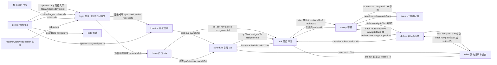

# 汇盈探店 · 探员端小程序 → H5 移植盘点清单（inventory）

> 本文档是小程序探员端（`apps/miniapp/miniprogram/`）全部功能与交互的无遗漏盘点，作为第 2 段 H5 实现与 vitest 测试断言的唯一依据。
> 所有结论均以代码为准，附 `file:line` 出处。行号基于 2026-10-10 工作区快照（只读盘点，未改动任何源文件）。

---

## 0. 盘点方法与统计摘要

**方法**：逐文件完整读取（无抽样）app.json / app.js / runtime-config.generated.js、11 个页面目录的 index.js + index.wxml + index.json（wxss 不涉及门控逻辑，仅按需核对 json 配置）、services 层 6 个文件、features/receipt-ocr.js、store 层 4 个文件、utils 层 3 个文件、packages/contracts/endpoint-registry.js；并用只读 grep 交叉核对：wx.* API 全量调用点、api.js 导出清单、`/api/me` 消费方、endpoint-registry 分组计数（node 只读执行 flatEndpoints()）。

**统计**：

| 项 | 数值 | 依据 |
|---|---|---|
| 页面数 | 11（app.json pages，登录页为首屏） | app.json:2-14 |
| tabBar 页 | 3：home 首页 / schedule 日程 / profile 我的 | app.json:21-46 |
| wxml 事件绑定位点 | 129 处（bindtap 80 / bindinput 19 / bindfocus 9 / bindblur 13 / bindchange 1 / catchtap 1 / bindkeyboardheightchange 2 / 验证码插件 bind:ready/verify/close/error 4 处） | grep 统计各页 index.wxml |
| 页面交互处理函数（wxml 可达） | 74 个（按「事件类型×处理函数」对计：login 11、location 3、home 4（goTask 同绑 bindtap 与 catchtap）、schedule 3、profile 4、task 4、survey 6、issue 8、dishes 24、other 7、help 0；另有验证码插件回调 4 个不计入） | 各页 index.wxml 绑定 + index.js 定义一一对应 |
| services/api.js 导出函数 | 33 个（另有 `export class BusinessError` 1 个，`grep -c "^export"` = 34） | api.js:10,56-97 |
| API 消费端点（registry 非组内未消费） | registry 非 admin 共 36 条（public 1 / auth 11 / assignments 5 / drafts 19），小程序消费 33 条；未消费 3 条：auth.me、auth.adminLogin、auth.adminLogout | endpoint-registry.js:6-15, grep 实查 |
| registry admin 组 | 60 条，小程序整体零消费 | endpoint-registry.js:17；flatEndpoints() 统计 admin=60 |
| 覆盖矩阵行数 | 34（33 个 api.js 导出函数 + app.js 直连 client-config） | §2 |
| wx.* API 去重种类 | 27 种 | §6（grep 全量清单） |
| storage key | `junde:session`、`junde:draft-index`、草稿键 `junde:survey:{userId}:{assignmentId}:{attemptId}:{versionId}` | store/session.js:1-2、store/survey.js:5-6 |
| 验证码插件 | wx 插件 `captcha` v2.1.4（provider wx1fe8d9a3cb067a75），组件 `plugin://captcha/t-captcha`，仅 login 页使用 | app.json:55-60、login/index.json:1、login/index.wxml:125 |

**种子事实复核结果（与 PM 给定不符处）**：
1. api.js 导出函数确为 33 个 ✅（第 34 个 `^export` 是 BusinessError 类，api.js:10）。
2. app.js 直连 `GET /api/public/client-config` ✅（app.js:27-28，不经过 api.js/request()，无 Bearer 头、无 dedupe）。
3. `/api/auth/me` 确认**无任何小程序消费方**：`grep -rn "auth\.me|/api/me"` 仅命中定义处 contracts.generated.js:76 与 endpoint-registry.js:10 ✅。
4. features/receipt-ocr.js 实际导出 **12 个函数 + 4 个常量**，PM 种子列的 10 个纯函数之外还有 `ocrStatusView`（receipt-ocr.js:46-53）与 `markDishEdited`（receipt-ocr.js:67-70），本文档全部收录。
5. 页面行数与 PM 参考值一致（dishes 433 / login 253 / other 240 / task 110 / survey 101 / issue 84 / schedule 72 / home 74 / profile 58 / location 17 / help 1）。

---

## 1. §页面清单

### 1.1 login 登录/注册/找回/重交（首屏页）

文件：`apps/miniapp/miniprogram/pages/login/index.js`（253 行）、index.wxml（127 行）、index.json（引入 t-captcha 插件组件）。

**a. 区块划分**（wxml）：
1. 品牌区：Logo「汇」+「汇盈探店」（wxml:3-6）。
2. 账号状态页 `step==='status'`：状态标题/说明 + （被拒且自助开放时）「修改并重新提交」按钮 + 「返回登录」（wxml:9-16）。
3. 顶部返回登录（非登录模式）（wxml:20-22）。
4. 标题区 headTitle/headSub（派生文案，wxml:25-28）。
5. 登录表单 `mode==='login'`：用户名、密码（含明文切换眼睛按钮）、登录按钮、（自助开放时）忘记密码/注册入口（wxml:31-54）。
6. 注册/重交/忘记密码表单 `mode!=='login' && selfServiceEnabled`：按 step（form/sms/password）显隐用户名、手机号、短信验证码、密码、确认密码字段 + 倒计时提示 + 行为验证状态区（不可用终态/加载中）+ 提交/重发/换号/返回按钮（wxml:57-121）。
7. 腾讯验证码插件组件 `#tcaptcha`：仅 `mode!=='login' && captchaAppId` 时渲染（wxml:125）。

**b. 交互流程**（事件 → 处理函数 → 条件 → 服务调用 → 状态变化）：

| 事件（wxml 位置） | 处理函数 | 触发条件/校验 | 服务调用 | 结果与状态 |
|---|---|---|---|---|
| bindtap（wxml:13） | `resubmit` (js:226) | step==='status' 且 accountStatus==='rejected' 且 selfServiceEnabled | 无 | mode→resubmit、step→form，清 phone/smsCode/challengeId |
| bindtap（wxml:15/21/112/120） | `goLogin` (js:112) | — | 无 | 复用 setMode 固定 mode=login |
| bindtap data-mode（wxml:51 forgot / 52 register） | `setMode` (js:113-116) | selfServiceEnabled 时才可见 | 无 | mode/step 重置，清 accountStatus/smsCode/challengeId/resetToken/maskedPhone，updateView 派生标题 |
| bindinput/bindfocus/bindblur（wxml:35/41/67/73/79/86/93/100） | `onInput`/`onInputFocus`/`onInputBlur` (js:119-121) | data-field 指定字段 | 无 | 写入 username/phone/password/confirmPassword/smsCode；focusField 控制高亮 |
| bindtap（wxml:42/80/87/94/101） | `togglePassword` (js:118) | — | 无 | showPassword 取反 |
| bindtap（wxml:47 登录 / 117 表单提交） | `submit` (js:227-234) 分发 | 按 mode+step 路由到下列函数 | 见下 | — |
| ↳ `submitLogin` (js:151-160) | | username 非空且 password 非空，否则 toast「请完整填写账号信息」 | `login({username,password})` (api.js:56 → POST /api/auth/login) | status==='approved_active' → `wx.redirectTo /pages/location/index` (js:156)；否则 step='status' 记录 accountStatus/rejectedReason |
| ↳ `sendRegisterCode` (js:161-171) | | 手机号 `/^1\d{10}$/`；密码≥10 字符且两次一致 | `obtainCaptchaTicket("register")`（captcha.js:3）→ `requestRegisterCode({phone,captchaTicket,captchaRandstr})` (api.js:58 → POST /api/auth/register/phone-code) | 记 challengeId=result.phoneChallengeId，step='sms'，maskedPhone=脱敏（js:253），startCountdown(result.resendAfterSeconds\|\|60) (js:236) |
| ↳ `submitRegister` (js:172-179) | | 验证码 `/^\d{6}$/` | `register({username,phone,password,confirmPassword,phoneChallengeId,smsCode})` (api.js:59 → POST /api/auth/register) | step='status'，accountStatus='pending_approval' |
| ↳ `sendResetCode` (js:180-190) | | 手机号格式 | `obtainCaptchaTicket("password_reset")` → `requestPasswordCode(...)` (api.js:61 → POST /api/auth/password-resets/code) | 同注册发码；另 toast「若该手机号已绑定账号，将发送验证码」(js:188) |
| ↳ `verifyResetCode` (js:191-198) | | 验证码 6 位 | `verifyPasswordCode({phoneChallengeId,smsCode})` (api.js:62 → POST /api/auth/password-resets/verify) | 记 resetToken，step='password' |
| ↳ `resetPassword` (js:199-207) | | 密码≥10 且两次一致 | `completePasswordReset({resetToken,password,confirmPassword})` (api.js:63 → POST /api/auth/password-resets/complete) | 回 login/form，清密码字段，toast「密码已重置，请重新登录」 |
| ↳ `sendResubmitCode` (js:208-217) | | 手机号格式 | `obtainCaptchaTicket("registration_resubmit")` → `requestRegisterCode(...)`（复用注册发码端点）(api.js:58) | 同发码流程 |
| ↳ `submitResubmit` (js:218-225) | | 验证码 6 位 | `resubmitRegistration({phoneChallengeId,smsCode})` (api.js:60 → POST /api/auth/registration/resubmit) | mode→login、step='status'、accountStatus='pending_approval' |
| bindtap（wxml:118） | `resend` (js:235) | countdown===0 | 无直接调用：回 step='form' 后调用 `this.submit()` 走原发码链路 | 重新发码（含验证码） |
| bindtap（wxml:119） | `changePhone` (js:117) | step==='sms' 可见 | 无 | step→form，清 smsCode/challengeId/maskedPhone |
| bindtap（wxml:111） | `retryPublicConfig` (js:67-74) | captchaAppId 为空且 captchaUnavailable 时可见 | `getApp().loadPublicConfig()`（app.js:24 直连 GET /api/public/client-config） | 成功且有 captchaAppId → 清 captchaUnavailable；无论成败重算 selfServiceEnabled（js:72） |
| bind:ready/verify/close/error（wxml:125） | `onCaptchaReady`/`onCaptchaVerify`/`onCaptchaClose`/`onCaptchaError` (js:83-110) | 插件组件事件 | 无 | verify 仅 `ret===0 且 ticket 非空` 才 resolve `{ticket,randstr}`，否则/关闭/出错 reject 为 BusinessError("captcha"或"captcha_cancel") (js:95-99) |
| `pending(work)` 包装 (js:237-249) | — | 所有提交流程经它防重（pending=true 禁重复） | — | 错误 kind 为 `captcha_rejected`/`sms_invalidated` 时置 captchaNeedsRefresh=true（下次展示前组件 refresh，js:244）；sms_invalidated 额外回 step='form' 清码 (js:245)；最终 toast error.message (js:250) |

**c. 页面状态**：
- 错误态：全部经 `pending()` 捕获 BusinessError 后 toast（js:246）；无页面级错误卡片。
- 验证码不可用终态：`!captchaAppId && captchaUnavailable` 显示「行为验证暂不可用」卡 + 重新加载/返回登录按钮（wxml:107-114）；仅 `!captchaAppId` 显示「行为验证加载中…」（wxml:115）。
- **门控**：注册/忘记密码入口（wxml:50-53）、自助表单整体（wxml:57）、被拒重交按钮（wxml:13）均受 `selfServiceEnabled = Boolean(publicConfig?.features?.authSelfService)` 门控（js:54-56，onLoad 求值 js:22）。开关关闭时被拒状态页改为文案「资料需修改，请联系管理员重新开放提交。」（wxml:14）。**publicConfig 未到达（或加载失败为 null）时 Boolean(undefined)=false → 入口保守隐藏**；JS 处理函数与后端链路完整保留（wxml:48-49 注释）。captchaAppId 缺失时 onLoad 主动触发一次 retryPublicConfig（js:23）。
- 账号状态页三种文案：pending_approval「申请正在审核中」/ rejected「注册申请未通过」+rejectedReason / 其他「账号已停用」（js:141-147）。

**d. 生命周期**：
- `onLoad(options)` (js:16-53)：接受 `options.mode` ∈ {login, register, forgot, resubmit}（如 profile 页跳转 `/pages/login/index?mode=forgot`，profile/index.js:32）；求值 captchaAppId 与 selfServiceEnabled；无 captchaAppId 则 retryPublicConfig；仅当无 entryMode 或 mode=login 时执行**冷启动会话探测**。
- 冷启动探测 `probeExistingSession` (js:58-66)：仅一次（sessionProbeDone）；有 accessToken 时调用 `getMyAssignments()`（api.js:66）作为会话有效性探测；成功且仍处于 login/form → `wx.switchTab /pages/home/index` (js:64)；失败（网络/会话失效）**不重试**，留在登录页。注意：探测不看 user.status，只看有无 accessToken。
- `onUnload` (js:75-81)：清倒计时 timer；未完成的验证 Promise 必须 reject（captcha_cancel），不留永久 pending。

### 1.2 location 隐私与定位（中转页）

文件：`pages/location/index.js`（17 行）、index.wxml（**单行压缩**，1 行）、index.json。

**a. 区块划分**：背景大字「到店」+ eyebrow「隐私与定位」+ 标题 + 说明文案 message + 三条隐私要点（打卡用/不持续定位/系统判定范围）+ 按状态显隐的按钮组（wxml:1）。

**b. 交互流程**：

| 事件 | 处理函数 | 条件 | 服务调用 | 结果 |
|---|---|---|---|---|
| bindtap | `locate` (js:6-14) | `status!=='ready'` 时显示该按钮（文案按状态：允许获取位置/重新定位） | `wx.getLocation({type:"gcj02",isHighAccuracy:true})` (js:8-13) | 成功 → globalData.locationStatus='ready'，status='ready'，文案「定位可用…」；失败 → status='blocked'，文案「未能获取位置…」 |
| bindtap | `openSettings` (js:15) | status==='blocked' | `wx.openSetting()` | 打开系统授权设置 |
| bindtap | `continue` (js:16) | status==='ready' | 无 | `wx.switchTab /pages/schedule/index` |

**c. 页面状态**：idle（默认提示「位置仅用于判断是否到店打卡，不持续记录轨迹。」）→ loading → ready / blocked（blocked 增补「打开设置」按钮）。无网络请求、无重试路径（重新定位即重试）。

**d. 生命周期**：`onLoad` 仅调 `requireApprovedSession()`（utils/auth.js:3-8），失败 reLaunch 登录页。

### 1.3 home 首页（tab）

文件：`pages/home/index.js`（74 行）、index.wxml（62 行）、index.json。

**a. 区块划分**：主色 Hero 标题区（wxml:3-6）；错误且无内容卡（9-13）；首次加载骨架（16-22）；空任务卡（25-28）；可执行任务大卡（31-41）；非阻塞错误条（44-47）；执行提醒卡（50-54）；三格只读统计（57-61）。

**b. 交互流程**：

| 事件 | 处理函数 | 条件 | 服务调用 | 结果 |
|---|---|---|---|---|
| bindtap（wxml:12/46） | `retry` (js:64) | refreshing 防重 | `getMyAssignments()` (api.js:66) | 重新 load |
| bindtap（wxml:27） | `goSchedule` (js:73) | 空任务态 | 无 | `wx.switchTab /pages/schedule/index` |
| bindtap 整卡（wxml:31）+ catchtap 按钮（wxml:40） | `goTask` (js:65-72) | navigating 防重、task 非空 | 无 | `wx.navigateTo /pages/task/index?assignmentId=…`（encodeURIComponent，complete 后清 navigating） |

**c. 页面状态**：
- 加载：首载 `loading=true` 显示骨架；已有内容时后台刷新不清空（js:46）。
- 错误：无内容 → 完整错误卡（error && !task）；有内容 → 非阻塞错误条（error && task）；文案取 error.message（BusinessError 自带中文）否则「暂时无法加载任务，请重试」（js:61）。
- 空态：「当前没有待执行任务」+ 查看全部日程。
- 下一项任务选择 `pickNextExecutable` (js:25-36)：只取 status ∈ {assigned, in_progress}；in_progress 优先于 assigned；同级按 dueAt 升序；经 `projectAssignmentForDisplay` 投影；若本地有匹配 revision 的草稿答案，附 `draftProgressText`「已完成 N / M 题」（`draftProgressOf` js:7-21 读 store/survey.js getDraft，草稿读取失败静默忽略 js:20）。
- 统计 counts：assigned / inProgress / overdue 三项计数（js:51-56）。
- 无门控状态（本页无 features 开关消费）。

**d. 生命周期**：`onShow` → `requireApprovedSession()` 通过才 `load()`（js:43）。无 onLoad 参数。

### 1.4 schedule 日程（tab）

文件：`pages/schedule/index.js`（72 行）、index.wxml（71 行）、index.json（`enablePullDownRefresh: true`）。

**a. 区块划分**：标题+总数（2-5）；状态筛选 chips 横滚（8-10，`filterChips.length>1` 才显示）；非阻塞错误条（13-16）；骨架（19-32）；完整错误态（35-39）；空态（42-45）；按日期分组的任务卡列表（48-70）。

**b. 交互流程**：

| 事件 | 处理函数 | 条件 | 服务调用 | 结果 |
|---|---|---|---|---|
| bindtap data-status（wxml:9 chips；wxml:44 空态重置） | `filterStatus` (js:52-57) | 值变化才处理 | 无（纯本地过滤） | statusFilter 更新 → applyFilter：全量 chip「全部 N」+ 四种状态 chip（仅 count>0 时出现，js:47-48）→ `groupAssignmentsByDate` 分组渲染 |
| bindtap（wxml:15/38） | `retry` (js:62) | refreshing 防重 | `getMyAssignments({force:true})` | 强制绕过 15 秒缓存重新加载 |
| bindtap data-id（wxml:53） | `goTask` (js:63-71) | navigatingId 防重复跳转 | 无 | `wx.navigateTo /pages/task/index?assignmentId=…`，卡片底部文案变「正在打开…」（wxml:66） |
| 下拉刷新（页面级） | `onPullDownRefresh` (js:58-61) | json 开启 | `load({force:true})` | 完成后 `wx.stopPullDownRefresh()` (js:60) |

**c. 页面状态**：首载骨架 / errorBlocking（无内容）完整错误卡「暂时无法加载日程」/ 空态（区分「当前筛选下没有任务」与「当前没有已分配任务」，后者提供重置筛选）/ 正常列表。任务卡字段来自 `projectAssignmentForDisplay`：statusText/statusTone/taskTypeText/storeName/name/displayDate/displayTime/displayDueDate/actionText（wxml:55-68）。

**d. 生命周期**：`onShow` → requireApprovedSession → load（js:20-23）。

### 1.5 profile 我的（tab）

文件：`pages/profile/index.js`（58 行）、index.wxml（39 行）、index.json。

**a. 区块划分**：用户信息卡（头像首字母 + displayName + 「探店员」+ 状态徽章）（wxml:3-12）；功能入口列表（wxml:15-35）；退出登录按钮（wxml:38）。

**b. 交互流程**：

| 事件 | 处理函数 | 条件 | 服务调用 | 结果 |
|---|---|---|---|---|
| bindtap（wxml:17） | `openSecurity` (js:25-34) | **整行 wx:if="{{false}}" 隐藏（死 UI，逻辑保留）**（wxml:16 注释：2026-08-13 策略） | 无 | showModal 引导退出后走忘记密码；确认 → `wx.reLaunch /pages/login/index?mode=forgot` (js:32) |
| bindtap（wxml:23） | `openPrivacy` (js:35) | — | 无 | `wx.navigateTo /pages/location/index`，fail 时 toast |
| bindtap（wxml:29） | `openHelp` (js:36) | — | 无 | `wx.navigateTo /pages/help/index`，fail 时 toast |
| bindtap（wxml:38） | `confirmLogout` (js:38-57) | loggingOut 防重 | showModal 确认后 `logout()` (api.js:57 → POST /api/auth/logout) | finally 无论成败 `wx.reLaunch /pages/login/index` (js:53)；API 失败先 toast error.message (js:51) |

**c. 页面状态**：状态徽章映射 pending_approval→「申请正在审核中」/warning、approved_active→「已启用」/primary、rejected→「申请未通过」/warning、disabled→「已停用」/muted、未知→「账号状态待确认」/muted（js:5-10,17）；头像取 displayName 首字符大写，缺省「探」（js:20）。

**d. 生命周期**：`onShow` → requireApprovedSession → 从 getSession() 读 user 渲染（js:14-24）。

### 1.6 task 任务详情

文件：`pages/task/index.js`（110 行）、index.wxml（88 行）、index.json。

**a. 区块划分**：骨架+慢加载提示（wxml:3-15，`loadSlow` 800ms 后出现，js:34）；加载错误卡（18-23）；任务 Hero（状态徽章/类型/门店/地址/时间窗）（27-35）；「本次要求」块（问卷名/预算/状态）（37-42）；「菜品要求」块（44-51）；specialInstruction 提示条（53）；submitted 只读块（56-60）；cancelled 块（63-68）；overdue 块（71-74）；明察未启用块（77-79）；开始流程区（82-86）。

**b. 交互流程**：

| 事件 | 处理函数 | 条件 | 服务调用 | 结果 |
|---|---|---|---|---|
| bindtap（wxml:21） | `retry` (js:65) | retrying 防重 | `getAssignment(assignmentId)` (api.js:73) | 重新 load |
| bindtap（wxml:22/67/73） | `backToSchedule` (js:66) | — | 无 | `wx.switchTab /pages/schedule/index` |
| bindtap（wxml:84） | `continueDraft` (js:67-72) | task.attempt?.id 存在且非 navigating | 无 | 直接 openSurvey（携 attemptId/revision），跳过打卡 |
| bindtap（wxml:85） | `start` (js:75-108) | 非 ACTIVE_PHASES（locating/checking_in/starting/navigating，js:10）且非 navigating；status ∉ {submitted, overdue, cancelled} (js:78) | 固定阶段链：`wx.getLocation` (js:80) → `checkIn(assignmentId,{latitude,longitude,accuracy,capturedAt})` (js:87, api.js:74) → `startAssignment(assignmentId)` (js:93, api.js:75) | checkIn result!=='accepted' → phase='failed' + checkinMessage 文案（accepted/outside_radius/stale/low_accuracy/rejected 五种映射，js:12-20）；定位失败 → phase='failed' + showModal「需要位置权限」确认后 `wx.openSetting()` (js:105)；成功 → phase='navigating' → `openSurvey` redirectTo 问卷（携 4 参数，js:109） |

**c. 页面状态**：
- 加载：骨架 + 800ms 慢提示（js:34）。
- 错误：errorBlocking（无内容）→ 错误卡 + 重新加载 + 返回日程；有内容时错误仅更新 error 字段非阻塞（js:60）。
- 门控分支（按 status/taskType 互斥）：submitted → 只读卡（提交时间 submittedAtLabel + 「提交后不能回看…」，wxml:56-60）；cancelled → 取消原因 cancelReason 或兜底文案 + 返回日程（63-68）；overdue → 警告块（71-74）；taskType==='overt' →「明察任务暂未启用」（77-79）；其余（assigned/in_progress）→ 开始区。
- **新字段归一**（js:48-57）：`address = raw.storeAddress || ""`；`windowLabel = formatTimeRange(startsAt,dueAt)`；`budgetLabel = formatBudgetLabel(budgetLimitCents)`；`dishRequirements = Array.isArray(raw.dishRequirements) ? raw.dishRequirements : []`；`specialInstruction = raw.specialInstruction || ""`；`submittedAtLabel = formatSubmittedAt(submittedAt)`；`statusLabel = mapAssignmentStatus(status).statusText`。

**d. 生命周期**：`onLoad(options)`：无 assignmentId → 错误态「未找到对应任务，请从日程重新进入」（js:31）；`onUnload` 置 unloaded 标记防异步 setData（js:30, 37-40）。

### 1.7 survey 暗访问卷（第一步：答题）

文件：`pages/survey/index.js`（101 行）、index.wxml（**单行压缩**，1 行）、index.json。

**a. 区块划分**：三步流程条（1 答题 active / 2 菜品与小票 / 3 其他记录，wxml:1）；分类 tab（selectCategory）；进度条文案「已完成 X / Y · syncMessage」；冲突横幅（conflict 时）；加载中；错误卡（retry）；题目卡列表（题号+分值、题干+展开、不得分摘要、得分/不得分按钮）；最后一类显示「下一步：菜品与小票」。

**b. 交互流程**：

| 事件 | 处理函数 | 条件 | 服务调用 | 结果 |
|---|---|---|---|---|
| bindtap data-id | `selectCategory` (js:79) | — | 无 | 切换分类 → project() 重算 visible/answeredCount/isLastCategory |
| bindtap（冲突横幅 & 错误卡） | `retry` (js:71) | — | `getQuestionnaire(assignmentId)` (api.js:76) | 清 conflict 重新 load |
| bindtap data-id | `toggleExpand` (js:80) | — | 无 | expanded[id] 取反（纯视图） |
| bindtap data-id「得分」 | `score` (js:81-92) | 当前答案为 unscored 时改为 `openIssue(id,"scored")` 走改分流程（js:84-85） | `saveAnswer(attemptId,questionId,{answer:"scored",revision})` (api.js:78 → PUT /api/questionnaires/secret/drafts/:id/answers/:questionId) | 乐观更新 answers + saveLocalDraft（store/survey.js:24）+「正在保存…」；成功 → revision 前进 + markDraftSynced +「已保存」；失败 → 回滚到 previous +「保存失败，请重试」+ toast（js:91） |
| bindtap data-id「不得分」 | `issue` (js:93) | — | 无 | `openIssue(id,"unscored")` → `wx.navigateTo /pages/issue/index?...&questionId=…&target=unscored`（6 参数，js:94） |
| bindtap「下一步：菜品与小票」 | `dishes` (js:95-100) | `firstIncompleteQuestion`（utils/business.js:26-44）找到未完成题 → 跳到该题分类 + toast「请先完成第 N 题」并**不进入**下一步 | 无 | 全部完成 → `wx.navigateTo /pages/dishes/index?（4 参数）` |

**c. 页面状态**：
- 加载 `load()` (js:30-70)：attempt.status==='submitted' → toast「该任务已提交，不能回看问卷内容」+ redirectTo task（js:34，**终态不可再进**）；attempt.id/questionnaireVersion.id 与路由不符 → 错误「问卷信息已更新，请从任务详情重新进入」（js:35）。
- 本地草稿合并：`peekDraft`（store/survey.js:18-22）取原始本地值 → `mergeSurveyAnswers`（store/survey-merge.js:8-20）四条规则（见 §1.7.d 附注）；conflict → 显示冲突横幅 + 保留本地值不覆盖（js:47-52）；无冲突 → saveLocalDraft + markDraftSynced（js:53-54）。
- **未同步答案补发**：merged.pendingResync 非空时按题顺序重发 saveAnswer 并推进 revision，期间 syncMessage「正在恢复未保存的答案…」，单题失败保留本地草稿（js:58-68）。
- 分类兜底：服务端 categories 空时用 FALLBACK_CATEGORIES（environment/service/product，js:7-9）；路由 category 参数延迟到服务端分类返回后校验（js:17, 22-29）。
- answeredCount 只统计当前题目集合内的答案（停用题不虚增，js:75-77）。

**d. 生命周期**：`onLoad(options)`：assignmentId/attemptId/questionnaireVersionId 任一缺失 → 错误态（js:14）；routeMeta 记录 4 参数 + pendingCategory。`onShow`：routeMeta 存在且非首载 → 重新 load（js:20，从 issue 页返回后刷新）。合并规则详见 `store/survey-merge.js:1-7` 注释。

### 1.8 issue 不得分/改分编辑（问卷子页）

文件：`pages/issue/index.js`（84 行）、index.wxml（**单行压缩**，1 行）、index.json（标题「不得分」）。

**a. 区块划分**：加载中「正在打开临时编辑…」；错误卡；题目卡（第 N 题 · X 分 + 题干）；target==='scored' 时改为确认卡「改为得分？」；否则：问题说明 textarea（必填）、问题照片卡（question.evidence.imageRequired 时）、问题音频卡（audioRequired 时）、底部取消/确认。

**b. 交互流程**：

| 事件 | 处理函数 | 条件 | 服务调用 | 结果 |
|---|---|---|---|---|
| bindinput | `remark` (js:20) | — | 无 | remark 更新 |
| bindtap「拍照或相册」 | `chooseImage` (js:21-26) | 剩余张数 = imageMaxCount(默认3) − 已有数，≤0 → toast | `wx.chooseMedia({count,mediaType:["image"],sourceType:["camera","album"]})` (js:25) | 逐个 stageFile |
| bindtap「录制/停止录制」 | `toggleRecord` (js:27-39) | 已有 ≥3 段 → toast；最长 audioMaxDurationSeconds(默认10)s；onStop 全局单例只绑一次（js:30-33），时长 <1s → toast | `wx.getRecorderManager()`，`recorder.start({duration,format:"mp3"})` (js:37) | recording 状态切换；完成后 stageFile |
| （内部）`stageFile` (js:40-52) | — | 单文件 >10MB → toast | 链式：`initEvidenceUpload` (js:46, api.js:81) → `uploadToSignedTarget(init.uploadTarget, path)` (js:47, api.js:97) → `completeEvidenceUpload(...{uploadToken,sizeBytes,durationSeconds})` (js:48, api.js:82) | completed.status!=='staged_ready' → 报错；成功占位项替换为 staged_ready；失败置 status='failed' + progressLabel=error.message |
| bindtap「重试」 | `retryUpload` (js:53) | 按 id 找到失败项 | 同 stageFile 链 | 先 removeLocal 再重传 |
| bindtap「删除」 | `deleteEvidence` (js:54) | id 以 `local-` 开头的本地项不调接口 | 非本地项 `removeEvidence(attemptId,questionId,editSessionId,id)` (api.js:83) | 失败 toast 并保留；成功 removeLocal |
| bindtap「播放」 | `play` (js:55-56) | item.path 或 previewUrl 存在 | `wx.createInnerAudioContext()` 单例复用 | 播放 |
| bindtap「取消」 | `cancel` (js:73) | 无 editSessionId 直接返回 | 有则 `cancelIssue(...)` (api.js:85) | `wx.navigateBack()` |
| bindtap「确认」 | `save` (js:58-72) | target==='unscored' 时：remark 必填；imageRequired 需 ≥1 张 active/staged_ready；audioRequired 需 ≥1 段；有 uploading 项则等待 | `updateEditSession(...{draftIssueRemark,revision})` (js:67, api.js:80) → `confirmIssue(...{answer:target,revision})` (js:68, api.js:84) | `wx.navigateBack()` 回问卷；失败 toast |

**c. 页面状态**：onLoad 拉取问卷定位题目 → `createEditSession({baseAnswerRevision, targetAnswer})` (js:15, api.js:79) 取 editSessionId + 会话内草稿（draftIssueRemark）/活动附件；题目不存在 → 错误「题目已更新，请刷新问卷后重试」（js:13）。附件项状态机：uploading → staged_ready / failed。音频实例 onUnload 统一销毁（js:57）。

**d. 生命周期**：`onLoad(options)` 六参数：assignmentId/attemptId/questionnaireVersionId/questionId 必填（缺一 → 错误态 js:7）+ revision + target（默认 "unscored"）。`onUnload` 销毁音频（js:57）。

### 1.9 dishes 菜品与小票（第二步，最大页）

文件：`pages/dishes/index.js`（433 行）、index.wxml（103 行）、index.json（`navigationStyle: "custom"` 自定义导航）。

**a. 区块划分**：自定义导航（返回=保存并回问卷，wxml:2-7）；三步流程条（第二步 active，wxml:9）；加载/错误态（11-12）；**消费小票区**（14-52：标题+必传星号+计数、加载/错误提示、小票网格[服务端瓦片/待上传瓦片/添加按钮]、OCR 面板[受门控]、OCR 错误条）；**菜品列表**（54-97：每道菜 = 主行[菜名输入/禁用占位+状态 picker+要求标签+满意度按钮]、业务标签行[来自小票/请核对/系统推算/已人工修改]、任务菜品行、替代原因/售罄原因条件 textarea、折叠区[数量/单价/行总价+评价]、折叠摘要按钮、错误条、删除按钮]）；添加菜品按钮（99）；页面级校验错误（100）；底部上一步/下一步（101）。

**b. 交互流程**（24 个处理函数）：

| 事件（wxml 位置） | 处理函数 (js) | 条件/校验 | 服务调用 | 结果 |
|---|---|---|---|---|
| bindtap（wxml:4/101） | `back` (js:354-358) | 存在空白额外菜品（isBlankExtraDish，utils/business.js:46-53）→ 标错并阻止 | `saveAndNavigate("survey")` → `saveDishes` | 保存后回问卷（routeToSurvey） |
| bindtap（wxml:12） | `retry` (js:93) | — | `getAssignment` + `getDraft` | 重新 load |
| bindtap（wxml:21） | `retryReceipts` (js:94) | **receiptLocked 时按钮隐藏** | `listReceiptAttachments` | 重拉小票列表 |
| bindtap data-url（wxml:25/35） | `previewReceipt` (js:267-271) | url 存在 | `wx.previewImage({current,urls})` (js:270) | 全屏预览（服务端+本地合集） |
| bindtap（wxml:30） | `replaceFailedReceipt` (js:245-265) | attachment.canRetry 且非 receiptBusy | chooseMedia 1 张 → `deleteReceiptAttachment(...,"keep_as_manual",revision)` (js:255) → 走 uploadPending | 删失败图换新图 |
| bindtap（wxml:31） | `deleteReceipt` (js:273-282) | canDelete 且非 receiptBusy | 单选项 → showModal 确认；双选项（removable_auto_rows）→ `wx.showActionSheet` (js:281) → `confirmDeleteReceipt` | `deleteReceiptAttachment(attemptId,id,dishHandling,revision)` (js:288, api.js:90)；结果含 dishes 时 acceptServerDishes (js:291) |
| bindtap（wxml:38） | `retryUpload` (js:235) | pending 失败项 | `uploadPending(clientFileId)` | 重传 |
| bindtap（wxml:39） | `removePending` (js:237-243) | 非 uploading/confirming 才可点 | 无 | 登记取消（cancelledUploads Set）+ 移除本地项 |
| bindtap（wxml:42） | `chooseReceipts` (js:189-200) | receiptBusy/canAddReceipt 门控；剩余=9−occupiedReceiptCount；`validateReceiptFiles`（receipt-ocr.js:15-24）校验张数/类型/10MB | `wx.chooseMedia` (js:192) + `wx.getImageInfo` 探测类型 (js:430) | 生成 pendingReceipts（local_selected）→ persistLocal → 逐个 uploadPending |
| （内部）`uploadPending` (js:202-233) | — | receiptBusy 防重；cancelledUploads 命中则放弃回填（js:213,220,223） | `initializeReceiptUpload` (js:211, api.js:88) → `uploadToSignedTarget(target,path,onProgress)` (js:219, api.js:97，进度回调更新百分比) → `completeReceiptUpload(...{...fileMeta,etag},revision)` (js:222, api.js:89) | 状态机 local_selected→uploading(1%→100%)→confirming→移出 pending；失败置 failed+message |
| bindtap（wxml:48） | `startOcr` (js:296-310) | ocrBusy 防重；无 ready 小票 → toast「请先完成消费小票上传」 | `createReceiptOcrJob(attemptId, readyIds, secureUuid(), revision)` (js:303, api.js:91) | job succeeded/partial → 立即 applyOcr；queued/processing → scheduleOcrPoll(0)；写 recovery{jobId,applyKey,appliedJobId} 并 persistLocal (js:304-305) |
| bindtap（wxml:49） | `restoreOcr` (js:349) | ocrError 时显示 | → `resumeOcr` (js:312-320)：`getReceiptOcrJob` (api.js:92) | 恢复轮询/应用 |
| （内部）`scheduleOcrPoll` (js:322-334) | — | pageVisible 且有 jobId | setTimeout 按 `nextPollDelay(attempt)`（receipt-ocr.js:42-44，[1000,2000,3000,5000] 封顶）调 `getReceiptOcrJob` | 终态 → applyOcr；轮询失败 → ocrError「识别进度暂时中断，请点击恢复」 |
| （内部）`applyOcr` (js:336-347) | — | appliedJobId/applyingJobId 去重 | `applyReceiptOcrJob(attemptId,jobId,applyKey,revision)` (js:340, api.js:93) | `applyOcrDishesOnce`（receipt-ocr.js:55-65，同 job 幂等、required 菜校验）成功 → acceptServerDishes + revision 前进 |
| bindtap（wxml:51） | `continueManual` (js:350) | — | 无 | 清 ocrError + 滚动到菜品列表 |
| bindinput+bindblur（wxml:59 菜名） | `input` (js:96-102) / `blur` (js:144) | — | 无 | OCR 来源菜品经 `markDishEdited`（receipt-ocr.js:67-70）标记 manuallyModified 并清 reviewFields；persistLocal |
| bindchange（wxml:62 状态 picker） | `status` (js:146-157) | 仅 requirementId 菜可换状态（picker disabled={{!item.requirementId}}） | 无 | 按 statusOptions[value] 切 fulfillmentStatus 并联动清字段（ordered 补默认菜名/替代售罄清空等，js:152-155） |
| bindtap（wxml:66） | `satisfied` (js:159-162) | 仅 active 菜显示 | 无 | fullySatisfied 取反 |
| bindinput（wxml:78/79/88） | `input` | 条件字段：替代原因/售罄原因/评价 | 无 | 同菜名 input 路径 |
| bindinput+bindblur（wxml:83） | `quantityInput` (js:126-131) / `quantityBlur` (js:133-142) | 整数 1–999，否则 amountError | 无 | blur 时 Number 化；priceDerived 时重算行总价（deriveLineTotal，receipt-ocr.js:72-78） |
| bindinput+bindblur（wxml:84/85） | `moneyInput` (js:104-110) / `moneyBlur` (js:112-124) | `parseYuanToCents`（receipt-ocr.js:26-34）非法 → amountError | 无 | 分存储 + `formatCentsToYuan` 回显；单价变化时按需推算行总价并置 priceDerived |
| bindtap（wxml:90） | `toggleFold` (js:165-168) | 仅 active 且折叠的菜显示摘要 | 无 | foldOpen 纯视图切换（不脏、不保存，js:164 注释） |
| bindtap（wxml:95） | `remove` (js:179-187) | 仅无 requirementId 的菜显示删除 | showModal 确认（文案区分 OCR/手工来源，js:183） | 移除 + persistLocal |
| bindtap（wxml:99） | `add` (js:170-177) | secureUuid 失败 → toast「当前环境不支持安全创建记录」 | 无 | 追加空白 extra 菜 + focus + 滚动定位 (js:175) |
| bindtap（wxml:101） | `next` (js:360-370) | 顺序校验：receiptRequired 时 readyCount≥1 → pending 上传中须完成 → `requiredReviewMessage`（receipt-ocr.js:80-83）→ amountError → `validateDish`（utils/business.js:12-24）；任一失败标错+滚动定位 | `saveAndNavigate("other")` → `saveDishes` | 保存成功 → `wx.navigateTo /pages/other/index?（4 参数）` (js:379) |

**c. 页面状态**：
- 加载链 `load()` (js:49-76)：getAssignment（status==='submitted' → `closeSubmitted`）→ getDraft（attempt 状态 ∈ submitting/processing/submitted → closeSubmitted；id 不符 → 错误）→ `firstIncompleteQuestion` 有未完成题 → toast + routeToSurvey(true)（js:58-59）→ 本地/服务端菜品合并（local.synced===false 且有 dishes 用本地，js:64-65）→ 恢复 receiptRecovery.pendingReceipts → loadReceipts → recovery.jobId 存在则 resumeOcr。
- 小票错误态：`receiptError`；**kind==='questionnaire_submitted'（409 终态）→ 固定文案 + receiptLocked=true 锁定重试**（js:87，wxml:21 按钮隐藏）。
- OCR 面板门控：`syncOcrEntry` (js:33-36) 读 `publicConfig?.features?.receiptOcr`；**onLoad 与 onShow 都重新求值；配置未到达前保守隐藏**（js:30-32 注释）；关闭时仅手工填写（wxml:45 注释）。OCR 按钮：无 job 或 failed → 「识别并带入菜品/重新识别」（disabled 当 ocrBusy 或 readyCount===0）；ocrError → 「恢复识别」（wxml:48-49）。
- 菜品折叠规则：active 且无 reviewFields 且单价数量齐备且无评价 → 默认折叠为摘要行（js:416-418，projectDish）；foldOpen 不进草稿序列化。
- 生命周期保存：onHide/onUnload 时 persistLocal（含 pendingReceipts 去 uploadTarget 脱敏 stripPendingSecrets，js:387, 426）；onHide 停轮询（js:397）。
- revision 跟随：listReceiptAttachments/initialize/complete/delete/OCR apply/saveDishes 的响应 revision 一律 `updateRevision` 前进（js:82,214,224,256,289,342,378,393）。

**d. 生命周期**：`onLoad`：navigationMetrics（wx.getWindowInfo/getMenuButtonBoundingClientRect/getSystemInfoSync，js:433）+ syncOcrEntry + 三参数校验；`onShow` (js:396)：pageVisible=true + syncOcrEntry + 未终态 job 恢复轮询；`onHide`/`onUnload` (js:397-398)：停轮询 + persistLocal。

### 1.10 other 其他记录与提交（第三步）

文件：`pages/other/index.js`（240 行）、index.wxml（76 行）、index.json（`navigationStyle: "custom"`）。

**a. 区块划分**：自定义导航（返回=保存并回菜品，wxml:2-7）；三步流程条（第三步 active，wxml:9）；加载中；**成功页** submitState==='submitted'（✓ + 提交时间 + 「本次问卷已锁定…」+ 确定按钮，wxml:13-19）；表单区（闪光点必填 textarea + 其他建议选填 textarea + 消息区[重新加载/重试提交按钮] + 提交/上一步按钮，wxml:21-75）。

**b. 交互流程**：

| 事件（wxml 位置） | 处理函数 (js) | 条件 | 服务调用 | 结果 |
|---|---|---|---|---|
| bindtap（wxml:4/72） | `back` (js:92-99) | locked()（submitting/processing/submitted，js:213）禁止 | `saveRecords` → `saveOtherRecords` | 成功后：栈>1 navigateBack，否则 redirectTo dishes (js:96-98) |
| bindinput+bindkeyboardheightchange（wxml:32-33/49-50） | `input` (js:82-88) / `keyboard` (js:90) | retryable_failed/terminal_failed 状态下输入即弃用旧 submitToken (js:84) | 无 | 值更新 + submitState 回 draft + persistLocal；keyboardOpen 控制底部留白 class (wxml:21) |
| bindtap（wxml:58） | `retryLoad` (js:80) | 仅 `!meta && message` 时显示 | 重新 load | — |
| bindtap（wxml:59） | `retrySubmit` (js:178-180) | submitState ∈ retryable_failed/processing | `submitWithExistingToken` → `submitQuestionnaire`（同 submitToken 幂等） | 处理中 → poll；成功 → complete |
| bindtap（wxml:67） | `confirm` (js:101-123) | locked 禁止；retryable_failed 且有 token → 直接 retrySubmit；highlight 空白 → highlightError + 滚动定位 (js:107-112) | `saveRecords` (js:113) → `saveOtherRecords(attemptId,{highlight,suggestion,revision})` (js:132, api.js:94) | 成功 → showModal「确认提交问卷？」(js:115-122) 确认后 `submit()` |
| （内部）`submit` (js:149-176) | — | 无 token 则 `secureUuid()` 生成（失败 → 「当前环境不支持安全提交」，js:152-154） | `submitQuestionnaire(attemptId,{submitToken,assignmentRevision,confirmation:true})` (js:157-161, api.js:95) | result.status==='processing' → submitState='processing' + poll (js:162-166)；其他 → complete；error.retryable → retryable_failed 保留 token；否则清 token → terminal_failed (js:168-175) |
| （内部）`poll` (js:201-204) | — | processing 状态 | 2500ms 后 submitWithExistingToken（同 token 重查提交结果） | 循环直至终态 |
| bindtap（wxml:18） | `done` (js:225) | 成功页 | 无 | `wx.switchTab /pages/schedule/index` |

**c. 页面状态**：
- 加载：getAssignment（submitted → toast+redirectTo task，js:41-45）→ getDraft（id 不符/状态 submitting/processing/submitted → toast+redirect，js:47-54）→ 本地 synced===false 用本地 highlight/suggestion（js:56-62）。
- **failed→draft 恢复**：`result.attempt.status === "failed"` → message「上次提交未完成，请检查内容后重新提交」（js:71），页面处于可编辑 draft 态，用户修改后重新提交（详见 §5.d）。
- submitState 状态机：draft → submitting → processing（轮询）/ submitted（成功页，clearDraft js:208）/ retryable_failed（可重试）/ terminal_failed（须改内容，输入后回 draft）。
- assignmentRevision 优先取 assignment.revision ?? result.assignment?.revision ?? meta.revision（js:64,136），随保存响应 saved.assignmentRevision 前进。

**d. 生命周期**：`onLoad` 四参数（缺一 → 错误消息）；`onUnload`：清 pollTimer + 未提交且 dirty 时 persistLocal（js:220-223）。

### 1.11 help 填写帮助（纯静态）

文件：`pages/help/index.js`（**单行** `Page({});`）、index.wxml（10 行）、index.json。
无任何交互与生命周期逻辑（js:1）。5 个静态帮助块：开始任务 / 答题规则 / 菜品与消费小票 / 提交前检查 / 定位与隐私（wxml:4-8）。从 profile「填写帮助」进入。

---

## 2. §覆盖矩阵（33 个 api.js 导出函数 + app.js 直连，34 行）

> method/path 取自 `services/contracts.generated.js` 的 API 表（与 `packages/contracts/endpoint-registry.js` 一一对应）。「交互」指页面里的触发点。

| # | 页面 | 交互/触发点 | 服务函数 (api.js 行) | method | path | 备注 |
|---|---|---|---|---|---|---|
| 1 | login | 登录按钮 submit→submitLogin (wxml:47, js:151) | `login` (56) | POST | /api/auth/login | 成功 saveSession+globalData.session+清任务缓存 |
| 2 | profile | confirmLogout showModal 确认 (js:49) | `logout` (57) | POST | /api/auth/logout | finally 清会话与任务缓存并 reLaunch 登录 |
| 3 | login | sendRegisterCode (js:166) / sendResubmitCode (js:212) | `requestRegisterCode` (58) | POST | /api/auth/register/phone-code | 前置 obtainCaptchaTicket（register / registration_resubmit 两种 scene） |
| 4 | login | submitRegister (js:175) | `register` (59) | POST | /api/auth/register | 成功进 pending_approval 状态页 |
| 5 | login | submitResubmit (js:221) | `resubmitRegistration` (60) | POST | /api/auth/registration/resubmit | 被拒后重交 |
| 6 | login | sendResetCode (js:184) | `requestPasswordCode` (61) | POST | /api/auth/password-resets/code | scene=password_reset |
| 7 | login | verifyResetCode (js:194) | `verifyPasswordCode` (62) | POST | /api/auth/password-resets/verify | 返回 resetToken |
| 8 | login | resetPassword (js:202) | `completePasswordReset` (63) | POST | /api/auth/password-resets/complete | 成功回登录 |
| 9 | login+home+schedule | login 冷启动探测 (js:63)；home onShow load (js:48)；schedule load/下拉/重试 (js:29,59,62) | `getMyAssignments` (66) | GET | /api/assignments/mine | 15s 按 userId 缓存（assignments-cache.js），force 跳过 |
| 10 | task+dishes+other | task load (js:44)；dishes load (js:53)；other load (js:40) | `getAssignment` (73) | GET | /api/assignments/:id | assertAssignment 校验 |
| 11 | task | start 阶段链 (js:87) | `checkIn` (74) | POST | /api/assignments/:id/check-in | dedupeKey `checkin:{id}`；body={latitude,longitude,accuracy,capturedAt} |
| 12 | task | start 阶段链 (js:93) | `startAssignment` (75) | POST | /api/assignments/:id/start | assertStart；dedupeKey `start:{id}` |
| 13 | survey+issue | survey load/重试 (js:33,71)；issue onLoad (js:11) | `getQuestionnaire` (76) | GET | /api/assignments/:id/questionnaire | assertQuestionnaire |
| 14 | dishes+other | dishes load (js:55)；other load (js:46) | `getDraft` (77) | GET | /api/questionnaires/secret/drafts/:id | assertQuestionnaire（复用问卷校验器） |
| 15 | survey | score (js:89) + pendingResync 补发 (js:61) | `saveAnswer` (78) | PUT | /api/questionnaires/secret/drafts/:id/answers/:questionId | assertRevision；dedupeKey `answer:{attemptId}:{questionId}` |
| 16 | issue | onLoad 建 编辑会话 (js:15) | `createEditSession` (79) | POST | /api/questionnaires/secret/drafts/:id/questions/:questionId/edit-sessions | assertEditSession |
| 17 | issue | save (js:67) | `updateEditSession` (80) | PATCH | /api/questionnaires/secret/drafts/:id/questions/:questionId/edit-sessions/:editSessionId | 保存草稿说明 |
| 18 | issue | stageFile (js:46) | `initEvidenceUpload` (81) | POST | …/edit-sessions/:editSessionId/evidence-uploads | assertUploadInit（attachmentId+uploadTarget） |
| 19 | issue | stageFile (js:48) | `completeEvidenceUpload` (82) | POST | …/evidence-uploads/:attachmentId/complete | status 须 'staged_ready' (js:49) |
| 20 | issue | deleteEvidence (js:54) | `removeEvidence` (83) | DELETE | …/edit-sessions/:editSessionId/evidence/:attachmentId | 仅非 local- 项 |
| 21 | issue | save (js:68) | `confirmIssue` (84) | POST | …/edit-sessions/:editSessionId/confirm | body={answer:target,revision} |
| 22 | issue | cancel (js:73) | `cancelIssue` (85) | POST | …/edit-sessions/:editSessionId/cancel | 放弃编辑会话 |
| 23 | dishes | saveAndNavigate (js:377) | `saveDishes` (86) | PUT | /api/questionnaires/secret/drafts/:id/dishes | assertRevision；dedupeKey `dishes:{attemptId}` |
| 24 | dishes | loadReceipts (js:81) | `listReceiptAttachments` (87) | GET | /api/questionnaires/secret/drafts/:id/receipt-attachments | assertReceiptList；dedupeKey `receipt-list:{id}`；409 终态见 §5.c |
| 25 | dishes | uploadPending (js:211) | `initializeReceiptUpload` (88) | POST | /api/questionnaires/secret/drafts/:id/receipt-attachments/uploads | body={fileMeta,revision}；dedupeKey `receipt-init:{id}:{clientFileId}` |
| 26 | dishes | uploadPending (js:222) | `completeReceiptUpload` (89) | POST | /api/questionnaires/secret/drafts/:id/receipt-attachments/:attachmentId/complete | body 含 etag；dedupeKey `receipt-complete:{id}:{attachmentId}` |
| 27 | dishes | confirmDeleteReceipt (js:288) / replaceFailedReceipt (js:255) | `deleteReceiptAttachment` (90) | DELETE | /api/questionnaires/secret/drafts/:id/receipt-attachments/:attachmentId | body={dishHandling,revision}；dishHandling ∈ keep_as_manual / remove_unmodified_ocr_rows |
| 28 | dishes | startOcr (js:303) | `createReceiptOcrJob` (91) | POST | /api/questionnaires/secret/drafts/:id/receipt-ocr-jobs | body={attachmentIds,idempotencyKey,revision}；dedupeKey `receipt-ocr-create:{id}:{key}` |
| 29 | dishes | resumeOcr/scheduleOcrPoll (js:315,328) | `getReceiptOcrJob` (92) | GET | /api/questionnaires/secret/drafts/:id/receipt-ocr-jobs/:jobId | dedupeKey `receipt-ocr-get:{id}:{jobId}` |
| 30 | dishes | applyOcr (js:340) | `applyReceiptOcrJob` (93) | POST | /api/questionnaires/secret/drafts/:id/receipt-ocr-jobs/:jobId/apply | assertReceiptOcrApply；dedupeKey 含 idempotencyKey |
| 31 | other | saveRecords (js:132) | `saveOtherRecords` (94) | PUT | /api/questionnaires/secret/drafts/:id/other-records | body={highlight,suggestion,revision} |
| 32 | other | submit / submitWithExistingToken (js:157,186) | `submitQuestionnaire` (95) | POST | /api/questionnaires/secret/:id/submit | body={submitToken,assignmentRevision,confirmation:true}；assertSubmit；dedupeKey `submit:{id}:{token}` |
| 33 | issue+dishes | issue stageFile (js:47)；dishes uploadPending (js:219) | `uploadToSignedTarget` (97) | POST | （服务端下发的预签名 URL，**无 registry 条目**） | wx.uploadFile；校验 method/url/fileFieldName/formData/expiresAt；捕获 ETag（§8） |
| 34 | app.js（非页面） | onLaunch → loadPublicConfig (app.js:24-42) | —（原生 wx.request 直连，不经 api.js） | GET | /api/public/client-config | timeout 5000；无 Bearer；失败 publicConfig=null（app.js:36-39） |

**矩阵自检**：33 个函数全部出现（第 1–33 行），无「无消费方」函数（每个都至少有一个页面调用）；第 34 行为 app.js 直连消费。

---

## 3. §API 消费总清单（与 endpoint-registry.js 双向对照）

registry 分组计数（flatEndpoints() 实测）：public 1 / auth 11 / assignments 5 / drafts 19 / **admin 60**，共 96。

### 3.a 正向：registry 非 admin 端点 → 小程序消费情况

| registry 条目 (group.name) | method+path | 是否消费 | 消费函数 | 触发页面 |
|---|---|---|---|---|
| public.clientConfig | GET /api/public/client-config | ✅ | app.js loadPublicConfig（原生 wx.request，app.js:27-28） | 启动时 + 登录页 retryPublicConfig |
| auth.login | POST /api/auth/login | ✅ | login | login |
| auth.logout | POST /api/auth/logout | ✅ | logout | profile |
| auth.registerPhoneCode | POST /api/auth/register/phone-code | ✅ | requestRegisterCode | login（注册+重交发码） |
| auth.register | POST /api/auth/register | ✅ | register | login |
| auth.registrationResubmit | POST /api/auth/registration/resubmit | ✅ | resubmitRegistration | login |
| auth.passwordCode | POST /api/auth/password-resets/code | ✅ | requestPasswordCode | login（忘记密码） |
| auth.passwordVerify | POST /api/auth/password-resets/verify | ✅ | verifyPasswordCode | login |
| auth.passwordComplete | POST /api/auth/password-resets/complete | ✅ | completePasswordReset | login |
| **auth.me** | GET /api/me | ❌ **无消费方**（grep 全库仅 contracts.generated.js:76、endpoint-registry.js:10 两处定义） | — | — |
| **auth.adminLogin** | POST /api/admin/auth/login | ❌ 无消费方（管理端专用，路径在 /api/admin 下） | — | — |
| **auth.adminLogout** | POST /api/admin/auth/logout | ❌ 无消费方 | — | — |
| assignments.mine | GET /api/assignments/mine | ✅ | getMyAssignments | login（探测）/home/schedule |
| assignments.byId | GET /api/assignments/:id | ✅ | getAssignment | task/dishes/other |
| assignments.checkIn | POST /api/assignments/:id/check-in | ✅ | checkIn | task |
| assignments.start | POST /api/assignments/:id/start | ✅ | startAssignment | task |
| assignments.questionnaire | GET /api/assignments/:id/questionnaire | ✅ | getQuestionnaire | survey/issue |
| drafts.byId | GET /api/questionnaires/secret/drafts/:id | ✅ | getDraft | dishes/other |
| drafts.answer | PUT /api/questionnaires/secret/drafts/:id/answers/:questionId | ✅ | saveAnswer | survey |
| drafts.editSessions | POST …/questions/:questionId/edit-sessions | ✅ | createEditSession | issue |
| drafts.editSession | PATCH …/edit-sessions/:editSessionId | ✅ | updateEditSession | issue |
| drafts.evidenceUploads | POST …/edit-sessions/:editSessionId/evidence-uploads | ✅ | initEvidenceUpload | issue |
| drafts.evidenceComplete | POST …/evidence-uploads/:attachmentId/complete | ✅ | completeEvidenceUpload | issue |
| drafts.evidence | DELETE …/evidence/:attachmentId | ✅ | removeEvidence | issue |
| drafts.confirmEdit | POST …/edit-sessions/:editSessionId/confirm | ✅ | confirmIssue | issue |
| drafts.cancelEdit | POST …/edit-sessions/:editSessionId/cancel | ✅ | cancelIssue | issue |
| drafts.dishes | PUT /api/questionnaires/secret/drafts/:id/dishes | ✅ | saveDishes | dishes |
| drafts.otherRecords | PUT /api/questionnaires/secret/drafts/:id/other-records | ✅ | saveOtherRecords | other |
| drafts.submit | POST /api/questionnaires/secret/:id/submit | ✅ | submitQuestionnaire | other |
| drafts.receiptAttachments | GET …/receipt-attachments | ✅ | listReceiptAttachments | dishes |
| drafts.receiptUploads | POST …/receipt-attachments/uploads | ✅ | initializeReceiptUpload | dishes |
| drafts.receiptComplete | POST …/receipt-attachments/:attachmentId/complete | ✅ | completeReceiptUpload | dishes |
| drafts.receiptAttachment | DELETE …/receipt-attachments/:attachmentId | ✅ | deleteReceiptAttachment | dishes |
| drafts.receiptOcrJobs | POST …/receipt-ocr-jobs | ✅ | createReceiptOcrJob | dishes |
| drafts.receiptOcrJob | GET …/receipt-ocr-jobs/:jobId | ✅ | getReceiptOcrJob | dishes |
| drafts.receiptOcrApply | POST …/receipt-ocr-jobs/:jobId/apply | ✅ | applyReceiptOcrJob | dishes |
| **admin 组（60 条）** | /api/admin/** | ❌ **整体零消费**（探员端不触达任何 admin 端点；adminLogin/adminLogout 虽登记在 auth 组但路径属管理端） | — | — |

**小结**：非 admin 36 条中消费 33 条、未消费 3 条（auth.me / auth.adminLogin / auth.adminLogout）。

### 3.b 反向：api.js 33 函数 + app.js → registry 条目名

login→auth.login；logout→auth.logout；requestRegisterCode→auth.registerPhoneCode；register→auth.register；resubmitRegistration→auth.registrationResubmit；requestPasswordCode→auth.passwordCode；verifyPasswordCode→auth.passwordVerify；completePasswordReset→auth.passwordComplete；getMyAssignments→assignments.mine；getAssignment→assignments.byId；checkIn→assignments.checkIn；startAssignment→assignments.start；getQuestionnaire→assignments.questionnaire；getDraft→drafts.byId；saveAnswer→drafts.answer；createEditSession→drafts.editSessions；updateEditSession→drafts.editSession；initEvidenceUpload→drafts.evidenceUploads；completeEvidenceUpload→drafts.evidenceComplete；removeEvidence→drafts.evidence；confirmIssue→drafts.confirmEdit；cancelIssue→drafts.cancelEdit；saveDishes→drafts.dishes；listReceiptAttachments→drafts.receiptAttachments；initializeReceiptUpload→drafts.receiptUploads；completeReceiptUpload→drafts.receiptComplete；deleteReceiptAttachment→drafts.receiptAttachment；createReceiptOcrJob→drafts.receiptOcrJobs；getReceiptOcrJob→drafts.receiptOcrJob；applyReceiptOcrJob→drafts.receiptOcrApply；saveOtherRecords→drafts.otherRecords；submitQuestionnaire→drafts.submit；**uploadToSignedTarget→无 registry 条目**（目标是服务端下发的预签名 uploadTarget.url，域名为对象存储，不在 API 注册表内）。app.js 直连→public.clientConfig。

### 3.c 对不上的项（差异清单）

1. `uploadToSignedTarget`（api.js:97-108）：调用对象存储预签名 URL，无 registry 条目（H5 移植时按「直传存储」语义保留，不是 /api 路径）。
2. `auth.me`（GET /api/me）：registry 有、小程序无消费方（疑似为 Web 端预留或历史遗留）。
3. `auth.adminLogin` / `auth.adminLogout`：登记在 registry auth 组（endpoint-registry.js:10），但路径为 /api/admin/*，探员端无消费（管理 Web 端使用）。
4. 无「小程序调用了 registry 之外 /api 路径」的情况（app.js 的 client-config 在 registry 内）。

---

## 4. §导航图与跨页规则

### 4.1 页面跳转关系（mermaid）

### 4.2 会话守卫

- `requireApprovedSession()`（utils/auth.js:3-8）：`session?.user?.status === "approved_active" && session.accessToken` 才返回 session；否则 `wx.reLaunch("/pages/login/index")` 并返回 null。使用方：home onShow（js:43）、schedule onShow（js:21）、profile onShow（js:15）、location onLoad（js:5）。**task/survey/issue/dishes/other 不调用守卫**，依赖 request() 的 401 统一处理兜底。
- 无会话冷启动：首屏为 login（app.json pages 首项）；probeExistingSession 无 accessToken 直接留在登录页（login js:61）。
- 已登录冷启动：login 探测 getMyAssignments 成功 → `wx.switchTab /pages/home/index`（login js:63-64）；失败不重试（js:65 注释）。
- 401 统一链路：presentError → kind "session" → `clearSessionAndUserCache()` + `assignmentCache.clear()` + `setTimeout(() => wx.reLaunch("/pages/login/index"), 0)`（api.js:42）。

### 4.3 tabBar 与非 tab 页跳转方式

- 3 个 tab（home/schedule/profile，app.json:21-46）只能 `wx.switchTab` 进入（location js:16、home js:73、task js:66、other js:225、login js:64）。
- 非 tab 页用 `wx.navigateTo`（进栈：task/survey/issue/dishes/other/help/location）、`wx.redirectTo`（替换：login→location js:156、task/survey/issue/dishes/other 的终态跳转、openSurvey js:109）、`wx.navigateBack`（issue js:69/73、dishes routeToSurvey js:394、other back js:97）、`wx.reLaunch`（清栈：401 api.js:42、守卫 auth.js:6、logout/openSecurity profile js:32/53）。
- 返回栈兜底：dishes.routeToSurvey 与 other.back 都按 `getCurrentPages().length > 1` 决定 navigateBack 还是 redirectTo（dishes js:394、other js:96-98）——H5 需等价实现「有历史则 back，无历史则 replace」。

### 4.4 页面间参数传递

| 目标页 | 参数 | 来源 |
|---|---|---|
| login | `mode` ∈ login/register/forgot/resubmit | profile openSecurity (js:32) |
| task | `assignmentId` | home js:69 / schedule js:68（均 encodeURIComponent） |
| survey | `assignmentId, attemptId, questionnaireVersionId, revision`（openSurvey js:109 / dishes routeUrl js:432）+ `category`（dishes 回跳固定 `&category=product`，js:394） | task/dishes |
| issue | 上述 4 + `questionId` + `target`(scored/unscored) | survey js:94 |
| dishes / other | 上述 4 | survey js:99 / dishes js:379 |
| revision 流转 | 所有写操作响应的 revision 经 updateRevision/markDraftSynced 回写 routeMeta，后续跳转携带最新值（survey js:62,90；dishes js:393；other js:133） | — |

本地草稿键 `junde:survey:{userId}:{assignmentId}:{attemptId}:{versionId}` 以四元组隔离（store/survey.js:6），首页进度、问卷合并、菜品恢复都依赖它（home js:10-15、survey js:38、dishes js:62-71、other js:56-62）。

---

## 5. §新语义（近期批次，H5 测试重点）

### 5.a features.authSelfService 与 features.receiptOcr 门控

- **加载链路**：App onLaunch → `loadPublicConfig()` 原生 GET /api/public/client-config（timeout 5000，app.js:27-29）→ 成功且响应为对象才写入 `globalData.publicConfig`；非 200/非对象/网络失败一律 `publicConfig = null`（app.js:30-40）。**缓存仅内存（globalData），无持久化**；apiBase 为空时直接返回 null（app.js:25）。
- **authSelfService**（登录页）：`resolveSelfService() = Boolean(publicConfig?.features?.authSelfService)`（login js:54-56），onLoad 求值（js:22）。UI 门控三处：登录页「忘记密码/注册」入口（wxml:50-53）、非登录表单整体（wxml:57）、被拒状态页「修改并重新提交」按钮（wxml:13）；关闭时被拒页显示「资料需修改，请联系管理员重新开放提交。」（wxml:14）。JS 流程（sendRegisterCode/register/…）与后端接口**不删**（wxml:49 注释）。
- **captchaAppId 与开关的耦合**：AUTH_SELF_SERVICE=disabled 时允许 captchaAppId 为 null 而配置整体仍有效（app.js:21-23 注释）——presentError/校验只要求响应是对象（app.js:31）。
- **登录页重试**：onLoad 时无 captchaAppId → `retryPublicConfig()`（js:23,67-74）重调 app.loadPublicConfig，成功则恢复 captchaAppId 并清 captchaUnavailable，**无论成败重算 selfServiceEnabled**（js:72）；失败进入明确终态卡（wxml:107-114），不永久 loading。
- **receiptOcr**（菜品页）：`syncOcrEntry() = Boolean(publicConfig?.features?.receiptOcr)`（dishes js:33-36），onLoad（js:40）与 onShow（js:396）都重新求值（publicConfig 异步晚到场景）；OCR 面板 `wx:if="{{ocrEnabled}}"`（wxml:46），关闭时只保留手工填写（wxml:45 注释）。**菜品页没有 publicConfig 重试入口**（与登录页不对称），配置未到达时保守隐藏 OCR、手工流程不受影响。
- **失败回退（保守行为）**：publicConfig 为 null 时两个开关等价 false → 注册/找回/重交入口隐藏、OCR 面板隐藏。H5 断言要点：门控值只能来自 client-config 响应的 `features` 对象；初始渲染（配置未到）两入口必须不可见/不可达。

### 5.b 任务详情新字段（task 页消费）

来源 `getAssignment` 响应，task js:48-57 归一，wxml 展示：
- `storeAddress` → `address`，Hero 区门店名下方展示，缺省空串（js:52；wxml:33）。
- `budgetLimitCents` → `formatBudgetLabel` → 「未设置」（0/缺失/非正整数）或「¥x.xx」（分转元两位小数）（js:54；utils/presentation.js:46-49；wxml:40「预算」行）。
- `dishRequirements` → 数组（非数组兜底 `[]`，js:55）；「菜品要求」块逐项 `plannedName × quantity` + 「必点/建议」（required 布尔），空数组显示「本次没有指定菜品。」（wxml:44-51）。
- `specialInstruction` → 非空才渲染高亮提示条 task-note（js:56；wxml:53）。
- 另有时间窗 `windowLabel = formatTimeRange(startsAt, dueAt)`（js:53；wxml:34）。
- dishes 页的菜品初始化同样消费 dishRequirements：无已存 dishes 时按 requirement 生成预填行（plannedName/quantity/required/allowSubstitution/instruction，dishes js:401-409）。

### 5.c 小票已提交 409 QUESTIONNAIRE_SUBMITTED 终态

- 映射：`presentError` 将 `error.code === "QUESTIONNAIRE_SUBMITTED"` → `BusinessError("questionnaire_submitted", "任务已提交，小票不可再查看或修改")`（api.js:17）。
- 页面行为：dishes.loadReceipts 捕获 `kind === "questionnaire_submitted"` → 设 `receiptError = 固定文案` + `receiptLocked = true`（dishes js:87）；wxml 中重试按钮 `wx:if="{{!receiptLocked}}"`（wxml:21）——**重试入口被锁定，不把冲突当普通失败裸报**（js:85-86 注释）。
- 再进入防护（同一终态的多层拦截）：survey.load attempt.status==='submitted' → toast「该任务已提交，不能回看问卷内容」+ redirectTo task（survey js:34）；dishes.load assignment.status==='submitted' 或 attempt.status ∈ {submitting,processing,submitted} → `closeSubmitted()`：toast「该问卷已关闭编辑」+ redirectTo task（dishes js:54,57,395）；other.load 同款拦截（other js:41-54）；task 页 submitted 态为只读卡且 start/continueDraft 均不可用（task wxml:56-60、js:78）。**结论：提交后问卷不可再进入查看，唯一落点是 task 只读详情。**

### 5.d 提交 failed→draft 恢复出口

- 位置：other 页。`load()` 发现 `result.attempt.status === "failed"`（上次提交失败已回 draft）→ 页面 message「上次提交未完成，请检查内容后重新提交」（other js:71），页面处于可编辑 draft 态（submitState='draft'，js:70）。
- 提交幂等：`submitToken = secureUuid()` 首次提交生成并复用（js:151-154）；`submitQuestionnaire` 以 dedupeKey `submit:{attemptId}:{token}` 防重（api.js:95）。
- 可重试失败：`error.retryable === true`（≥500 网络/服务类）→ submitState='retryable_failed'，消息「{错误}，可以重试提交」，**保留 token**，出现「重试提交」按钮（wxml:59）走 `retrySubmit → submitWithExistingToken`（同 token 重放，js:178-199）。
- 终态失败：非 retryable → 清空 token、submitState='terminal_failed'（js:172-174）；用户一旦重新输入内容即弃用旧 token 回 draft（js:84）。
- processing 轮询：每 2500ms 用同 token 重查提交结果直至成功/失败（js:201-204）。
- 成功：`complete()` → `clearDraft`（删除本地草稿键）+ 成功页（提交时间 + 「本次问卷已锁定」）+ done 回日程（js:206-211,225）。

---

## 6. §wx 平台能力清单（H5 适配器分解依据）

### 6.1 四个数据面适配器

**http（wx.request）**：
- api.js:35（request() 核心：拼接 apiBase、12s 超时、JSON 头、Bearer 注入、状态码分派、校验器、dedupe）
- app.js:27（loadPublicConfig 直连：5s 超时、无 Bearer、无 dedupe）

**storage（wx.setStorageSync/getStorageSync/removeStorageSync）**：
- store/session.js:4-5（会话 `junde:session` 读写）、9-12（清会话+按用户清草稿索引）、17-19（registerDraftKey 写索引 `junde:draft-index`）
- store/survey.js:11,20（getDraft/peekDraft 读）、27,36（saveDraft/markDraftSynced 写）、40（clearDraft 删）

**upload（wx.uploadFile 及任务句柄）**：
- api.js:100-106：上传到预签名 URL；`task.onProgressUpdate` 进度回调（0-100 截断，js:106）；无 task 句柄视为失败（js:105）

**location（wx.getLocation 等）**：
- location/index.js:8-13（gcj02 + isHighAccuracy，结果只置状态不发送）
- task/index.js:80-81（gcj02 + isHighAccuracy + highAccuracyExpireTime:5000，成功后组装 {latitude,longitude,accuracy,capturedAt} 发 checkIn）
- 授权声明：app.json:47-54（scope.userLocation 用途文案 + requiredPrivateInfos:["getLocation"]）

### 6.2 UI 层原语

| API | 调用处（file:line） | 用途 |
|---|---|---|
| wx.showToast | login:250; issue:77; dishes:176,195,199,252,299,380,395,59; other:42,51,142; profile:35,36,51; survey:34,91,97（共 19 处） | 轻提示（均 icon:"none"） |
| wx.showModal | profile:27,40; task:105; dishes:183,278; other:115（共 6 处） | 确认弹窗（退出登录/删菜/删小票/提交确认/定位权限/账号安全） |
| wx.showActionSheet | dishes:281 | 删除小票二选一（移除识别菜品/转手工） |
| wx.navigateTo | dishes:379; home:68; profile:35,36; schedule:67; survey:94,99（7 处） | 进栈跳转 |
| wx.redirectTo | dishes:394,395; login:156; other:43,52,98; survey:34; task:109（8 处） | 替换跳转 |
| wx.switchTab | home:73; location:16; login:64; other:225; task:66（5 处） | tab 切换 |
| wx.navigateBack | dishes:394; issue:69,73; other:97（5 处） | 返回 |
| wx.reLaunch | api.js:42; profile:32,53; utils/auth.js:6（4 处） | 清栈（登录/401/守卫） |
| wx.pageScrollTo | dishes:175,350,361,384; other:109（5 处） | 锚点滚动（dish-#id / .receipt-section / .dish-list / #highlight-field） |
| wx.previewImage | dishes:270 | 小票全屏预览 |
| wx.stopPullDownRefresh | schedule:60 | 结束下拉刷新 |
| wx.openSetting | location:15; task:105 | 打开授权设置 |

### 6.3 归不进四类的其他 wx.*（附建议归属）

| API | 调用处 | 用途 | 建议 H5 归属 |
|---|---|---|---|
| wx.chooseMedia | issue:25; dishes:192,248 | 相机/相册选图（count/mediaType/sourceType） | 设备面（媒体选择适配器） |
| wx.getImageInfo | dishes:430 | 探测图片类型（png/jpeg） | 设备面 |
| wx.getRecorderManager | issue:28 | 录音（mp3，最长 N 秒，onStop 单例绑定） | 设备面（录音适配器） |
| wx.createInnerAudioContext | issue:56 | 音频播放（单例复用，onUnload destroy） | 设备面 |
| wx.getWindowInfo / wx.getSystemInfoSync | dishes:433; other:234 | 状态栏高度（自定义导航） | UI 面（H5 通常不需要，可删） |
| wx.getMenuButtonBoundingClientRect | dishes:433; other:235 | 胶囊按钮位置（推导航高度） | UI 面（H5 不需要） |
| wx.getRandomValues | utils/business.js:3 | secureUuid 的安全随机（回退 globalThis.crypto，再回退抛错 SECURE_RANDOM_UNAVAILABLE） | 工具面（H5 用 crypto.getRandomValues 即可） |
| wx.getAccountInfoSync | app.js:10 | envVersion 判断开发环境（决定 apiBase 回退） | 环境面（H5 用构建时变量替代） |

> tabBar 图标（assets/tabbar/*.png，app.json:30-44）与插件（captcha v2.1.4，app.json:55-60）为小程序专有资源：前者 H5 需自行实现底部导航，后者需替换为 Web 验证码方案（ticket/randstr 契约不变，见 §8 验证码链）。

---

## 7. §展示语义速查（utils/presentation.js 全部 9 个导出函数）

文件：`apps/miniapp/miniprogram/utils/presentation.js`（纯函数、无 wx 依赖、设备本地时区，js:1-3 注释）。

### 7.1 safeDate(value)（js:10-14）
输入任意值 → Date 或 null。`safeDate("2026-08-11T10:00:00")` → Date；`safeDate("")` → null；`safeDate(undefined)` → null；`safeDate("not-a-date")` → null（NaN 检查，杜绝 Invalid Date 上屏）。

### 7.2 formatDateHeading(value)（js:23-27）
→ 「M月D日 周X」；无效 → 「时间待确认」。例：`formatDateHeading("2026-08-11")` → "8月11日 周二"（按本地时区解析）；`formatDateHeading(null)` → "时间待确认"。

### 7.3 formatTimeRange(startIso, endIso)（js:30-36）
同天 → 「HH:mm–HH:mm」；跨天 → 「HH:mm 开始」；end 无效 → 「HH:mm 起」；start 无效 → 「时间待确认」。例：("2026-08-11T19:32","2026-08-11T20:03") → "19:32–20:03"；跨天 → "19:32 开始"；end=null → "19:32 起"。

### 7.4 formatSubmittedAt(value)（js:39-43）
→ 「M月D日 周X HH:mm」；无效 → 「时间待确认」。例："2026-08-11T19:32" → "8月11日 周二 19:32"。

### 7.5 formatBudgetLabel(cents)（js:46-49）
非正整数/0/缺失 → 「未设置」；否则 → 「¥整数.两位小数」。例：12345 → "¥123.45"；0 → "未设置"；null → "未设置"；-1 → "未设置"。

### 7.6 mapAssignmentStatus(status)（js:51-62）
| status | statusText | statusTone | actionText |
|---|---|---|---|
| assigned | 待开始 | primary | 查看任务 |
| in_progress | 进行中 | dark | 继续填写 |
| overdue | 已逾期 | warning | 查看详情 |
| submitted | 已提交 | neutral | 查看状态 |
| cancelled | 已取消 | muted | 查看详情 |
| 未知值 | 状态待确认 | muted | 查看详情（isActionable:true） |

### 7.7 taskTypeText(taskType)（js:64）
"secret"→"暗访"；"overt"→"明察"；其他（含 undefined）→ ""。

### 7.8 projectAssignmentForDisplay(assignment)（js:70-89）
输出纯展示字段：id；storeName 缺省「门店待确认」；name 缺省「任务待确认」；taskTypeText 缺省「任务」；displayDate=formatDateHeading(startsAt)；displayTime=formatTimeRange(startsAt,dueAt)；displayDueDate=跨天时的 dueAt 标题否则 ""；displaySubmittedAt=formatSubmittedAt(submittedAt)；statusText/statusTone/actionText 来自 7.6；isActionable = status ∈ {assigned,in_progress,overdue,submitted,cancelled}（js:87）。约定：**原始 ISO 时间不得直接进模板**（js:67 注释）。

### 7.9 groupAssignmentsByDate(assignments)（js:92-104）
按 displayDate 分组，保持服务端顺序与组内原序；输出 [{dateHeading, items:[投影对象]}]。空数组 → []。

---

## 8. §附：services 层内部机制（H5 request 层需等价复刻）

文件：`apps/miniapp/miniprogram/services/api.js`（108 行）。

### 8.1 request() 与 dedupe
- 模块级 `pending = new Map()`（js:5）；key = 显式 `dedupeKey` 或默认 `${method}:${url}`（js:31）；进行中的同 key 请求**直接复用同一 Promise**（js:32,52）；Promise settle 后 finally 删除 key（js:51），因此 dedupe 只合并**并发**请求、不缓存结果。
- 带 dedupeKey 的函数：checkIn、startAssignment、saveAnswer、saveDishes、listReceiptAttachments、initializeReceiptUpload、completeReceiptUpload、deleteReceiptAttachment、createReceiptOcrJob、getReceiptOcrJob、applyReceiptOcrJob、saveOtherRecords、submitQuestionnaire（各自行号的 dedupeKey 模板见 §2 备注；submitQuestionnaire 的 key 含 submitToken，同 token 幂等重放依赖它）。

### 8.2 超时与响应校验
- `TIMEOUT_MS = 12000`（js:6），所有 request 与 uploadToSignedTarget 共用；app.js 的 client-config 单独 5000（app.js:29）。
- 非 2xx → presentError；2xx → `validate(response.data)`（默认 assertObject），校验器抛错 → `BusinessError("contract", "服务返回的数据暂时无法使用，请稍后重试")`（js:45-46）。
- wx.request 无 task 返回（极端环境）→ BusinessError("network")（js:50）。
- 网络失败：errMsg 含 timeout → kind "timeout"/「请求超时，请检查网络后重试」，否则 kind "network"/「暂时无法连接服务，请检查网络后重试」，均 retryable（js:48）。
- 14 个 assert* 校验器（contracts.generated.js:114-127）：assertObject、assertAssignment（id 非空字符串）、assertAssignmentList（items 数组且逐项 assertAssignment）、assertStart（attempt.id+attempt.revision+questionnaireVersion.id）、assertQuestionnaire（attempt/questionnaireVersion/questions 数组/answers 对象）、assertRevision（revision 非负整数）、assertEditSession（id）、assertUploadInit（attachmentId+uploadTarget）、assertReceiptUploadInit（attachment.id+uploadTarget+revision）、assertReceiptList（items 数组+revision）、assertReceiptMutation（=revision）、assertReceiptOcrJob（id+status 字符串）、assertReceiptOcrApply（job+dishes 数组+revision）、assertSubmit（status 字符串）。

### 8.3 认证与缓存
- Bearer 注入：`session?.accessToken` 存在时加 `Authorization: Bearer ${token}`，否则不带（js:38）；Accept/Content-Type 恒为 application/json。
- assignmentCache（store/assignments-cache.js:5-20）：Map 按 userId 隔离，TTL 15000ms；`get(userId,{force})` force 或无 userId 直接 miss；过期项惰性删除；`set` 仅在 userId 存在时写。清空时机：login 成功（api.js:56）、logout（js:57 finally）、401（js:42）。
- 会话存取（store/session.js）：`junde:session` 整包存取（js:4-5）；`clearSessionAndUserCache`（js:7-14）按 `junde:draft-index` 中当前用户的键逐个删除草稿、再删索引项与会话本身，并清 globalData.session。

### 8.4 presentError 完整映射表（api.js:14-28，逐条）

| 触发（优先级自上而下） | BusinessError.kind | 用户文案 | 附加 |
|---|---|---|---|
| error.code ∈ {SMS_CODE_INVALIDATED, SMS_CODE_ATTEMPTS_EXHAUSTED} | sms_invalidated | 验证码已失效，请重新发送并完成人机验证 | 登录页消费：captchaNeedsRefresh + 回表单（login js:244-245） |
| error.code === QUESTIONNAIRE_SUBMITTED | questionnaire_submitted | 任务已提交，小票不可再查看或修改 | dishes 页消费：receiptLocked（§5.c） |
| error.code === CAPTCHA_EXPIRED | captcha_rejected | 验证已过期，请重新验证 | 登录页 captchaNeedsRefresh |
| error.code ∈ {CAPTCHA_REJECTED, CAPTCHA_CANCELLED} | captcha_rejected | 验证未通过，请重新验证 | 同上 |
| statusCode === 401 | session | 登录已失效，请重新登录 | 触发清会话+清缓存+reLaunch（js:42） |
| statusCode === 403 | forbidden | 你没有权限进行此操作 | — |
| statusCode === 409 | conflict | `payload.error.message`（透出后端中文）\|\| "内容已更新，请刷新后重试" | requiresNewToken 透传（js:23） |
| statusCode >= 500 | service | 服务暂时不可用，请稍后重试 | retryable: true |
| error.code === RECEIPT_LIMIT_EXCEEDED | validation | 最多只能上传 9 张消费小票 | — |
| error.code === RECEIPT_FILE_INVALID | validation | 请选择 10MB 以内的图片 | — |
| 兜底 | validation | 操作未完成，请检查填写内容 | — |
| （网络层）超时 / 失败 | timeout / network | 请求超时… / 暂时无法连接服务… | retryable: true（js:48） |
| （校验层）assert 抛错 | contract | 服务返回的数据暂时无法使用，请稍后重试 | js:46 |

> 前端自产 kind（非 presentError）：`captcha`（验证码链路各失败点，captcha.js:5,10、captcha-host.js:16,20、login js:40,98,109）、`captcha_cancel`（用户关闭/页面卸载，login js:80,104）、`upload`（uploadToSignedTarget，js:99-105）。

### 8.5 uploadToSignedTarget（js:97-108）
- 入参：`{url, method, fileFieldName, formData, expiresAt}`（来自 init 响应的 uploadTarget）+ `filePath` + `onProgress`。
- **参数校验**：`method !== "POST" || !url || !fileFieldName || !formData || new Date(expiresAt) <= new Date()` → 立即 `BusinessError("upload", "上传链接已失效，请重新上传")`（js:99）——即只支持 POST、链接未过期。
- 成功（2xx）→ `resolve({ etag: response.header?.ETag || response.header?.etag || null })`（js:102，**ETag 大小写双捕**，null 允许）；非 2xx → "暂时无法上传小票，请重试"（retryable）；fail → "暂时无法上传小票，请检查网络后重试"（retryable）；无 task → "暂时无法上传小票，请稍后重试"（retryable）。
- 进度：`task.onProgressUpdate` → `onProgress(clamp(0..100))`（js:106）。etag 由调用方塞进 completeReceiptUpload 的 fileMeta（dishes js:222）。

### 8.6 行为验证码链路（三件套）
1. `captcha-config.js:5-7`：`resolveCaptchaAppId()` 读 `globalData.publicConfig.captchaAppId`（包内无任何密钥/占位值，js:1-4 注释）。
2. `captcha-host.js:8-24`：页面 `registerCaptchaHost({verify})` 注册一次性宿主（login js:33-52，内部 selectComponent("#tcaptcha") 并 show/受控 refresh）；`createCaptchaAdapter()` 产出全局 adapter：host 缺失或 verify 无 ticket → BusinessError("captcha")。
3. `captcha.js:3-13`：`obtainCaptchaTicket(scene)` 调 adapter 并校验 `ticket.ticket` 非空字符串，返回 `{ticket, randstr: ticket.randstr || ""}`（randstr 仅 Web 场景存在，允许为空——**H5 移植时 randstr 语义需与后端二次校验对齐**）。
- scene 取值：register（login js:165）、password_reset（js:183）、registration_resubmit（js:211）。**登录本身不需要验证码**。

### 8.7 本地问卷草稿与合并（store 层，测试对齐用）
- `store/survey.js`：identity 四元组键（js:3-7，缺任一抛 DRAFT_SCOPE_MISSING）；getDraft 按 revision 过滤、不匹配返回空结构（含 receiptRecovery 空骨架，js:12）；peekDraft 读原始值（js:18-22）；saveDraft 合并 patch 且 synced=false + savedAt（js:24-30）；markDraftSynced 写 synced=true（js:32-38）；clearDraft 删键（js:40）。
- `store/survey-merge.js:8-20` 四条规则：① 无未同步本地 → 用服务端；② synced=false 且 revision 相等 → 本地字段覆盖同题 + 计算 pendingResync（answer==='scored' 且与服务器不同的题，js:13-16）；③ synced=false 且服务端 revision 更大 → conflict=true；④ 本地 revision 更大 → 以本地为准（无 resync）。
