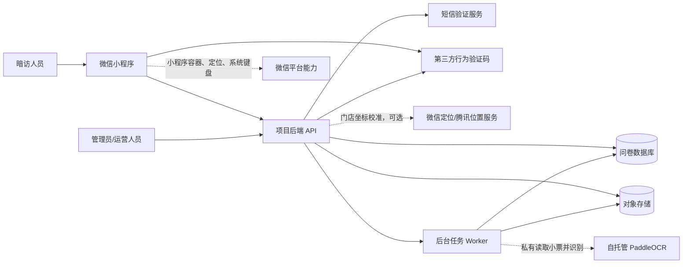

# 暗访问卷项目边界说明

## 1. 文档目的

本文档定义整个“暗访问卷”项目的产品、技术和交付边界，作为后续产品设计、开发、测试和需求变更的判断依据。

项目目标是：让通过审核的探店员使用自己的账号登录微信小程序，在门店允许半径内完成现场打卡，填写门店检查问卷，记录得分/不得分原因及后台要求的图片、音频证据，上传消费小票并由 OCR 辅助录入菜品，最后将人工确认后的结果提交给后台管理方。

本文档与 [video_replication_spec.md](./video_replication_spec.md)、[assignment_spec.md](./assignment_spec.md)、[BACKEND_DESIGN.md](./BACKEND_DESIGN.md)、[STATE_MACHINE_OVERVIEW.md](./STATE_MACHINE_OVERVIEW.md) 配套使用：本文定义项目边界，视频规格定义页面和交互，任务分配规范定义管理员如何把探店员、门店、问卷版本和必点菜品组合为独立任务，后端规范固定数据库、COS、PaddleOCR、安全和运维实现，状态机总览只负责统一可视化。

## 2. 系统边界



### 2.1 项目负责的内容

- 微信小程序页面、导航、表单和状态管理。
- 探店员自助注册、管理员审批、账号登录和手机号找回密码。（2026-08-13 策略调整：小程序端注册/找回密码 UI 已隐藏，后端能力保留。）
- 门店坐标、允许打卡半径、定位精度冗余和现场打卡校验。
- 暗访问卷题库及其分类、分值、顺序（启用题号 1..N 连续，数量不设上限）。
- 得分/不得分答案、必填问题说明，以及按题目配置的图片/音频证据保存。
- 消费小票拍照/相册选择、私有上传、预览、删除、OCR 辅助识别和人工校对。
- 菜品名称、数量、单价、行总价、外观/口味评价、满意状态及 OCR 来源的保存。
- “闪光点”和“其他建议”的保存。
- 问卷提交、重复提交防护、提交成功反馈和提交后锁定。
- 父任务、逐人任务分配、必点菜品、执行时间和特别说明。
- 后端问卷数据接口、权限校验、管理员工作台和基础运营闭环。
- 题目答案、菜品记录、最终提交记录的审计数据。

### 2.2 项目不负责的内容

- 门店 POS、点餐、库存、支付、会员、排班或财务系统。
- 暗访人员的线下身份真实性、工作证真实性和现场行为监管。
- 微信之外的独立 App、网页端或桌面端客户端。
- 语音识别算法本身。视频使用的是系统输入法的语音转文字能力。
- 通过算法自动判断卫生、服务或菜品质量。
- 提交后的在线自助修改。第一阶段不开放退回或重开；后续如立项，只能追加不可变的更正版本，不能覆盖原始提交。
- 多人共同编辑、共享或接力填写同一个问卷实例。
- 与问卷无关的企业级人事、财务、采购和门店经营管理。
- 持续后台定位、行动轨迹跟踪或在任务打卡之外采集位置。
- 离线提交、断网后自动同步和多设备实时协同，除非单独立项。

## 3. 用户与外部角色边界

| 角色 | 负责的动作 | 不属于该角色的动作 |
|---|---|---|
| 暗访人员 | 自助注册并等待审批；登录后查看自己的分配，在门店范围内打卡，按要求填写问卷和证据并提交 | 审批自己的账号、编辑他人问卷、共同编辑同一问卷、管理题库、查看全部门店数据 |
| 超级管理员 | 管理账号、角色、权限、组织和全局配置 | 代替暗访人员完成现场检查 |
| 运营管理员 | 创建任务、分配暗访人员、查看进度、审核提交、导出结果 | 私下修改原始答案或绕过审核链路 |
| 复核/整改人员 | 查看问题证据、发起整改或补充更正请求、跟进整改、关闭问题 | 修改原始问卷事实或改变审计记录 |
| 门店负责人 | 查看授权范围内的结果、提交整改说明和复核材料 | 查看其他门店或暗访人员隐私数据 |
| 微信平台 | 小程序容器、定位授权、系统键盘和基础设备能力 | 保存本项目业务数据、决定问卷是否合格 |
| 对象存储 | 私有保存不合格图片/音频证据、消费小票和整改附件 | 判断门店是否合格或自动修改评分 |
| 第三方行为验证码 | 在注册/找回密码等高风险操作中识别人机风险，并向后端提供可核验票据 | 直接批准账号或重置密码 |
| 短信服务 | 向已绑定手机号发送注册/找回密码验证码 | 保存密码、决定账号审批结果 |
| 腾讯位置服务 | 辅助门店坐标选点、地址解析和地图展示 | 替代服务端的打卡距离与权限判断 |
| 自托管 PaddleOCR | 从私有小票图片中提取中文文本和位置；本项目解析器再生成菜品候选、数量和金额 | 直接决定评分、替代人工确认或修改原始小票 |

## 4. 功能范围

### 4.1 第一阶段必须实现：暗访问卷主流程

1. 问卷首页。
2. 暗访问卷入口。
3. 按评估分类展示题目（分类由管理员扩展，默认：环境卫生、为客服务、产品品质；题量不设上限，启用题号 1..N 连续）。
4. 题目全文展开/收起。
5. 每题选择得分或不得分。
6. 不得分时必须填写非空问题说明；后台可按题目要求至少上传 1 张图片、至少上传 1 段音频，图片和音频可以同时要求。
7. 题目完成度校验。
8. 菜品记录：新增菜品、填写名称、填写评价、标记全部满意。
9. 其他记录：必填闪光点、可选其他建议。
10. 提交前不可逆确认。
11. 提交成功提示。
12. 提交后锁定，不能在客户端继续编辑。
13. 从自己的任务分配进入问卷；每个分配只生成一份归属于该探店员的独立问卷。
14. 菜品记录展示管理员为该探店员设置的必点菜品，并允许记录额外菜品。
15. 探店员自助注册用户名、密码和手机号；手机号验证后进入待审批状态，只有管理员批准的启用账号可以登录和被分配任务。
16. 忘记密码必须经过第三方行为验证码、短信验证码和新密码二次输入；同一短信验证码最多错误输入 3 次。
17. 登录后首次进入小程序获取一次位置；开始任务时必须重新取得新鲜定位并在门店有效半径内完成打卡。
18. 每条分配持久化 `secret | overt` 任务类型；第一阶段只能发布暗访任务，明察任务仅可保存草稿。
19. 任务逾期后禁止直接提交，必须由管理员延期到未来后才能继续。
20. 探店员提交后只能查看任务状态和提交时间，不能回看问卷答案、菜品、说明和证据。
21. 菜品记录页支持一次选择、整份问卷最多保留 9 张消费小票；上传成功后由服务端 OCR 辅助识别菜名、数量、单价、行总价和小票总额，并自动带入可编辑菜品行。
22. OCR 结果必须由探店员核对和修改；OCR 失败时仍可手动录入。任务要求小票时只以至少 1 张服务端确认上传成功的原图作为提交条件，不以 OCR 成功作为提交条件。
23. 管理员提交详情同时只读展示小票原图、OCR 原始候选、探店员最终菜品和字段差异，不能通过后台覆盖原始提交。

### 4.1.1 永久单人问卷规则

- 一份问卷永远只能由一个探店员编辑和提交。
- 同一门店、同一父任务可以同时分配多个探店员，但必须为每个人创建独立分配和独立问卷实例。
- 多名探店员可以使用相同问卷模板和版本，但不能共享 `attempt_id`。
- 系统所有阶段都不实现共同编辑、共享草稿或问卷接力。
- 管理员只能分配和查看；第一阶段不能退回、重开或代填原始问卷。后续更正也只能新增版本，不能覆盖原始提交。

### 4.1.2 永久 UI 业务化表达规则

所有产品角色能直接看到的界面都只能使用业务语言，包括探店员、超级管理员、运营管理员、复核人员和门店负责人使用的页面、弹窗、提示、通知、加载/空/错状态和下载文件名称。该规则对管理员界面同样生效，不设置“管理员可以看工程信息”的例外。

任何用户可见 UI 都禁止出现：

- 数据库 ID、UUID、`assignment_id`、`attempt_id`、内部题目 ID。
- 数据库字段名、表名、SQL、JSON 或原始接口响应。
- API 路径、HTTP 状态码、内部错误码和服务名称。
- `draft`、`submitted`、`409 Conflict` 等内部枚举或协议文本。
- submit token、幂等键、revision、storage key 和对象存储地址。
- 堆栈、异常类型、日志、环境名、调试开关和构建信息。

界面应显示对应业务表达：

- 内部任务 ID → 人类可读的任务名称或业务任务编号。
- 问卷版本 ID → 问卷名称和业务版本标签。
- 内部状态枚举 → “待开始”“进行中”“已提交”“已逾期”等中文状态。
- HTTP/并发错误 → “内容已更新，请刷新后重试”等可执行提示。
- 网络或服务异常 → “暂时无法完成操作，请稍后重试”，不得直接显示技术原因。

工程信息只能进入受控日志、监控和审计存储，不能直接绑定到文本组件、弹窗或 Toast。

### 4.1.3 永久不合格证据规则

- 问题说明是所有不得分答案的固定必填项，不提供后台关闭开关；只包含空格的内容视为未填写。
- 后台编辑题目时提供“不得分时要求上传证据”勾选项。勾选后展开“需要图片”和“需要音频”两个子选项，至少选择一个；两个都选表示两种证据分别必填。
- 只勾选图片时至少有 1 个上传成功的图片附件；只勾选音频时至少有 1 个上传成功的音频附件；两者都勾选时两项都必须满足。
- “已选择本地文件”不等于“上传完成”。只有附件状态为上传成功并完成服务端归属校验，该题才算完成。
- 点击下一题、切换离开当前题、进入菜品记录和最终提交时都要校验；前端用于即时提示，服务端仍须按问卷版本再次校验。
- 证据要求属于题库版本。问卷版本发布后不可原地修改，历史草稿和提交继续使用其绑定版本的要求。

### 4.1.4 永久现场打卡规则

- 门店保存 GCJ-02 坐标、业务半径和最大定位误差冗余。建议默认业务半径 300 米，允许按门店在 100–1000 米内配置。
- 为商场等室内场景提供定位冗余：有效阈值为“门店业务半径 + 本次定位精度值”，但精度补偿最多 200 米；定位精度差于 200 米时不继续放大范围，而是提示移动到开阔处重试或由管理员走受控异常流程。
- 小程序使用高精度 GCJ-02 定位。开始任务时的位置样本必须是 60 秒内取得的结果，服务端使用门店同坐标系坐标重新计算直线距离，不信任客户端传入的“在范围内”布尔值。
- 现场打卡只证明设备在允许地理范围内，不证明个人身份或现场行为绝对真实；定位异常不得由客户端静默绕过。
- 只保存打开小程序后的必要定位状态和打卡证据，不持续采集轨迹。

### 4.1.5 已确定的流程规则

- 底部“问卷”入口不保存全局当前分配：0 条可执行任务显示空状态，1 条进入该任务，多条先显示选择器。
- 打卡豁免必须有权限、原因、最长 30 分钟有效期和完整审计；每条分配最多一个有效豁免，并在首次开始问卷时原子消费。
- 不得分详情使用临时编辑会话。新增证据先暂存，删除原附件只记录意图；确定时原子提交，取消时原数据不变并清理新暂存对象。
- 提交事务开始后，所有说明、答案、菜品和附件写接口均关闭，包括上传初始化、上传完成和附件删除；迟到的对象存储回调不能改变已提交快照。
- `secret` 暗访和 `overt` 明察是持久化任务类型，不由页面入口临时推断。第一阶段未实现明察流程，因此包含明察分配的父任务不能发布。
- 超过截止时间时，服务端把分配标记为已逾期并拒绝提交；管理员延期后，未开始任务回到待开始，已有草稿回到进行中。
- 逾期拒绝会终结本次提交 token；管理员延期后客户端刷新任务 revision 并生成新 token。只有未产生业务结果的进程崩溃或瞬时故障允许原 token 按租约恢复。
- 父任务状态持久化：第一条分配开始后进入进行中；存在逾期分配时仍为进行中并显示逾期数；全部分配提交或取消后完成。每分钟状态推进任务和所有分配状态事务使用同一个聚合规则。

### 4.1.6 永久消费小票与 OCR 规则

- 消费小票属于整份问卷实例，不属于某一道题或某一道菜；一份问卷最多保留 9 张非删除状态的小票图片，一次选择数量不得超过剩余名额。
- 小程序只负责选择文件、展示进度和发起业务请求；原图进入私有对象存储，OCR 云密钥、签名和永久存储密钥只能保存在服务端。
- “已选择本地图片”不等于小票已完成。只有服务端校验文件签名、大小、校验和、对象归属并标记为上传成功的附件，才计入 `receipt_required`。
- OCR 是异步辅助能力，原图是审计事实。OCR 候选与探店员最终菜品分开保存，人工修改不得覆盖 OCR 原始候选。
- OCR 至少尝试提取菜名、数量、单价、行总价和每张小票总额；缺失或低置信度字段必须提示人工核对，不得编造价格，也不得把折扣、服务费、支付方式等非菜品行自动当成菜品。
- OCR 结果自动带入时必须幂等。管理员预设的必点/建议菜品及其 `requirement_id` 不得被覆盖或重复创建；可靠匹配时填充实际信息，歧义项保持待核对，未匹配项作为额外菜品候选。
- OCR 失败、部分成功或供应商不可用时保留原图和现有草稿，允许重试或完全手动录入；只要原图满足任务要求，OCR 失败不能阻止最终提交。
- 删除已参与 OCR 的小票必须明确处理其带入菜品：未人工修改的自动行可以随图删除；人工修改、绑定任务要求或有其他来源的行必须保留为手工记录或由用户明确确认，不能静默删除。
- 问卷进入 `submitting | submitted` 后，小票上传初始化、上传完成、删除、OCR 创建、OCR 应用和菜品修改全部拒绝；迟到的存储/OCR 回调不能进入提交快照。
- 管理员只读查看短时授权原图、OCR 原始候选、最终菜品和差异；任何角色界面都不得显示对象键、云服务请求 ID、原始供应商错误或其他工程信息。

### 4.2 第一阶段受限或占位功能

- 明察问卷：页面显示入口和“工作证 + 短信验证”文案，但验证流程不纳入暗访问卷 MVP。
- 底部“日程”：第一阶段用于展示当前探店员自己的分配和任务详情。
- 底部“我的”：展示当前账号、审批/启用状态、退出登录和密码安全入口，不承担管理员功能。

### 4.3 管理员能力分层

管理员不是单纯的“查看提交记录”角色，而是负责“任务 → 执行 → 审核 → 整改 → 复核 → 归档”的闭环。管理员对原始问卷必须遵守只读和审计原则，不能无痕修改暗访人员的事实记录。

#### 第一阶段必须实现：最小运营闭环

1. 管理员登录、退出、密码/登录态管理。
2. 探店员注册申请列表：查看用户名、脱敏手机号、申请时间和状态；批准或拒绝必须写审计日志，拒绝可填写业务原因。
3. 角色和权限校验：至少区分超级管理员、运营管理员、复核人员、门店负责人。
4. 门店基础资料：门店名称、编号、区域、状态、GCJ-02 坐标、打卡半径和定位精度冗余上限。
5. 暗访父任务：指定门店、整体时间窗口和共用说明。
6. 逐人任务分配：只能选择已批准且启用的探店员，并分别选择问卷版本、开始/截止时间、必点菜品、预算、小票要求和特别说明。
7. 题库编辑：配置题目顺序、分值，以及不得分时是否要求图片/音频证据；发布后冻结版本。
8. 任务进度：未开始、进行中、已提交、已逾期、已取消。
9. 提交记录列表：按门店、时间、任务、分配、探店员、状态和问题数量筛选。
10. 提交记录详情：查看三类题目答案、不得分说明、图片/音频证据、小票原图、OCR 原始候选、菜品要求及最终记录、字段差异、闪光点和其他建议。
11. 结果摘要：总分、得分率、不得分数量、分类得分和高风险问题数量。
12. 原始记录只读：管理员默认不能直接覆盖原答案、原备注和原始提交时间。
13. 基础导出：导出当前筛选结果或单份问卷，导出动作写入审计日志。
14. 提交异常处理：查看失败记录、重复提交拦截结果和接口错误状态。
15. 数据看板：按提交时间统计得分趋势、门店月度得分、门店大项（评估分类）得分率与考核点得分率，支持日期/品牌/城市/区域/门店筛选，并导出 Excel 统计表（复用导出任务审计链路）。

#### 第二阶段应实现：质量与整改闭环

1. 题库管理增强：新增、编辑、停用题目；批量复制证据规则和版本差异预览。
2. 题库版本：草稿、预览、发布、生效、停用；已提交问卷固定使用提交时的题库版本。
3. 任务模板：按区域、门店类型或检查周期复用任务配置。
4. 暗访人员管理：账号、状态、区域权限、任务历史和提交质量。
5. 审核动作：通过、标记需复核、退回补充说明、转整改。
6. 问题台账：问题分类、严重级别、责任门店、负责人、截止时间、处理状态。
7. 整改协作：门店上传整改说明、图片或附件；复核人员通过/驳回并留下意见。
8. 受控修改：管理员发起修改窗口，暗访人员重新提交新版本；原提交保留，新旧版本可对比。
9. 统计报表：按时间、门店、区域、分类、问题类型和整改状态统计。
10. 通知：任务分配、临期、逾期、退回、整改完成和复核结果通知。
11. 操作审计：记录操作者、时间、动作、对象、前后值、原因和来源 IP/设备信息。

#### 第三阶段可选：高级运营能力

1. 门店风险排名和趋势分析。
2. 自动生成周报/月报。
3. 题目权重、抽题和随机顺序策略。
4. 批量创建任务、批量分配和批量导出。
5. 对接企业消息、工单系统或 BI 平台。
6. 明察问卷完整身份验证和独立工作流。

#### 管理员明确不能做的事

- 不能直接删除已提交问卷，只能作废并保留原因和审计记录。
- 不能无理由修改暗访人员的得分、不得分说明、菜品评价和闪光点。
- 不能通过改题库影响已经提交的历史问卷。
- 不能让门店负责人查看其他门店或未授权的暗访人员身份信息。
- 不能把“总分”当作唯一结论；必须保留分类结果、问题说明和证据。

### 4.4 其他第二阶段能力

- 明察问卷完整身份验证。
- 跨设备云端草稿、断点续填和离线同步。
- 离线填写、断网同步和多设备协同。
- 自动语音识别服务、自动评分和 AI 整改建议。

## 5. 页面边界

### 5.1 小程序页面

| 页面 | 必须承担的责任 | 不承担的责任 |
|---|---|---|
| 注册/登录 | 注册用户名、密码和手机号，展示待审批/被拒绝状态；已批准账号登录（2026-08-13：注册/找回密码 UI 已隐藏，后端能力保留） | 不允许客户端自行批准或改变账号状态 |
| 忘记密码 | 完成人机验证、短信验证码校验和新密码二次确认（2026-08-13：UI 已隐藏，后端能力保留） | 不显示手机号是否已注册，不绕过服务端票据校验 |
| 定位启动页 | 说明定位用途并申请授权，展示当前位置是否可用于现场打卡 | 不持续追踪位置，不在客户端决定最终打卡结果 |
| 问卷首页 | 展示问卷入口和完成后的返回落点 | 不展示管理员数据和统计报表 |
| 日程/任务列表 | 只展示当前探店员自己的任务分配 | 不展示其他探店员的任务或答案 |
| 任务详情/现场打卡 | 展示门店、问卷版本、时间和要求；重新定位并在有效半径内打卡 | 不允许更换问卷版本、查看他人分配或绕过定位 |
| 暗访问卷 | 展示题目、分类和答案状态 | 不直接决定门店最终等级 |
| 不得分详情 | 必填问题说明，并按题库版本上传必需图片/音频证据 | 不自动判断证据真假或生成整改建议 |
| 菜品记录 | 记录菜品和评价 | 不连接 POS 自动读取菜品 |
| 其他记录 | 记录闪光点和建议 | 不自动归类问题或生成报告 |
| 提交确认/成功 | 防误提交、显示不可逆结果 | 不提供提交后在线编辑 |
| 管理员工作台 | 管理任务、查看进度、审核提交、处理整改和导出授权范围内的数据 | 不在暗访人员端混入管理功能 |

### 5.2 页面之间的责任转移

```text
注册 / 登录 / 审批状态 / 忘记密码
  └─ 定位启动页
       └─ 日程/任务列表
            └─ 当前探店员的任务详情
                 └─ 现场定位打卡
                      └─ 问卷首页
                           └─ 路由中显式选择的独立暗访问卷
                                ├─ 环境卫生 / 为客服务 / 产品品质
                                │    └─ 题目答案、不得分说明与图片/音频证据
                                ├─ 菜品记录
                                │    └─ 小票上传/OCR、必点要求、实际菜品、数量/价格、评价和满意状态
                                └─ 其他记录
                                     └─ 闪光点、其他建议、最终提交
```

题目页面只负责题目答案；菜品页面只负责菜品；其他记录页面只负责补充信息。跨页面的数据必须通过统一的问卷草稿状态管理，不允许各页面各自维护一份互不一致的数据。

## 6. 数据边界

### 6.1 项目需要保存的数据

- 问卷实例：模式、状态、创建时间、提交时间、提交人标识。
- 用户账号：规范化用户名、密码哈希、手机号、手机号验证时间、审批状态、审批人/时间和账号启停状态。
- 密码重置：一次性挑战、验证码摘要、错误次数、过期/使用状态和发送审计；不保存明文验证码。
- 门店定位：GCJ-02 坐标、业务半径、精度补偿上限和最后校准信息。
- 现场打卡：任务分配、定位时间、经纬度、精度、计算距离、有效阈值和校验结果。
- 打卡豁免：分配、原因、授权人、有效期、消费/撤销状态和审计。
- 父任务：门店、整体时间窗口、状态和共用说明。
- 任务分配：唯一探店员、`secret | overt` 任务类型、问卷版本、个人时间窗口、预算、小票要求、特别说明和创建/开始/提交时间。
- 必点菜品：菜名、数量、是否必点、是否允许替代、预算和观察要求。
- 题目答案：题目 ID、答案类型、分值、不得分说明，以及归属该题的图片/音频附件。
- 不得分编辑会话：基线 revision、暂存附件、待移除附件和确认/取消/过期状态。
- 菜品记录：对应的必点要求、排序、计划/实际名称、履行状态、数量、单价、行总价、OCR 来源、人工修改标记、评价和是否全部满意。
- 消费小票：归属问卷实例的私有附件、上传状态、文件校验信息和顺序，不归属某一道菜。
- 小票 OCR：异步任务状态、输入摘要、供应商/解析器版本、原始规范化候选、字段置信度、小票汇总金额及与最终菜品的来源关系。
- 其他记录：闪光点、其他建议。
- 操作审计：创建、修改草稿、提交、提交失败、管理员修改。

### 6.2 项目不应保存的数据

- 不必要的通讯录、微信好友、短信通讯录和设备通讯录。
- 与问卷无关的定位轨迹、相册全量内容和麦克风原始音频。
- 明文密码、可逆加密密码、明文短信验证码、行为验证码密钥或长期有效的密码重置凭证。
- 输入法语音识别产生的原始录音；项目只接收用户确认后的文字。
- POS 订单、支付卡号、银行卡信息或门店经营机密，除非另行批准接口和权限。

### 6.3 数据状态

```text
draft       可编辑的问卷草稿
submitting  已发起提交，禁止重复提交
submitted   已提交，只读
failed      提交失败，可在安全范围内重试
```

`submitted` 是不可逆业务状态。客户端不能通过重新打开页面、修改本地缓存或重复请求把已提交记录恢复为可编辑状态。

`submitting` 必须绑定 submit token、请求摘要和短时处理租约。租约内不重复执行；进程崩溃后，如果没有提交快照且确认不存在外部副作用，恢复器将其转为 `failed`，允许同 token 重试；若快照已经存在则对账为 `submitted`。逾期等已提交业务拒绝不属于可重试失败，必须更换 token。

## 7. 后端与前端责任边界

### 前端必须负责

- 题目、菜品、其他记录的输入体验。
- 当前页面状态、加载态、空态、错误态和提交中状态。
- 必填校验和未完成题目提示。
- 定位授权、定位刷新、上传进度、失败重试和下一题前的即时校验。
- 小票最多 9 张的选择/预览、OCR 处理状态、低置信度提示、自动带入后的人工校对和失败时手工降级。
- 防止用户连续点击造成重复请求。
- 退出、返回、Tab 切换和键盘弹出时不丢失当前输入。

### 后端必须负责

- 题库和题目版本的真实来源。
- 用户/任务访问权限。
- 注册审批状态、密码哈希验证、行为验证码票据二次校验、短信验证码次数/时效和密码重置凭证。
- 打卡距离、定位时间新鲜度、定位精度和门店半径的最终校验。
- 分配所有权校验；只有分配中的探店员可以创建、编辑和提交对应问卷。
- 题目 ID、答案枚举、分值和提交状态校验。
- 不得分说明及图片/音频证据要求的版本化校验。
- 小票单对象短时上传授权、真实文件签名/大小/校验和/归属确认，以及每份问卷最多 9 张的事务约束。
- OCR Provider 调用、job 租约/重试/幂等、供应商结果规范化，以及候选与最终菜品的分离保存。
- OCR 候选 `apply` 的菜品 revision 校验、管理员要求行保护、重复应用防护和删除来源小票时的菜品影响裁决。
- 草稿和最终提交的持久化。
- 提交接口幂等性。
- `receipt_required` 只计算当前问卷 `ready` 原图；`submitting | submitted` 后拒绝小票/OCR/菜品写入并隔离迟到回调。
- 已提交记录只读控制。
- 管理员操作的权限和审计。

### 双方都不能假设

- 前端显示“全部完成”就等于后端数据完整。
- 用户重复点击一定只会产生一次请求。
- 客户端本地缓存一定可靠。
- 网络断开后数据一定已经同步。

### ~~当前零后端起点的阶段边界~~（历史背景，2026-08-10 已过时）

> 以下描述的是 2026-07 前端先行阶段的起点。2026-08-10 全栈收口后，仓库已具备正式 Fastify API、PostgreSQL 17 migration、私有 COS 签名/校验、PaddleOCR sidecar/worker 与管理员真实操作闭环；本段仅保留历史边界说明，不再作为当前结论。后续实现仍必须遵守：fixture 只能由测试注入、生产默认路径不得伪造上传/OCR/保存/提交成功。

- 测试 fixture 只能由自动化测试或明确的本地开发注入启用，生产默认路径不得伪造上传、OCR、保存或提交成功。
- 前端选中本地图片只能进入本地等待/上传状态；没有服务端完成确认时不能出现 `ready` 业务结果，不能满足 `receipt_required`。
- 真实小票能力必须在认证、问卷所有权、草稿 revision、私有上传和提交锁建立后接入；OCR worker 与候选应用在此基础上实施。
- 管理员差异页可以先使用契约 fixture 验证布局，但只有数据范围、短时原图授权和真实提交快照接通后才算交付。
- 前端 Agent 的完成汇报必须列出尚未实现的后端接口、COS 和 OCR，不得把浏览器演示或 contract server 当成产品环境。

## 8. 外部依赖边界

| 依赖 | 第一阶段策略 | 失败时行为 |
|---|---|---|
| 微信小程序容器 | 必须依赖 | 显示容器/登录错误并允许重试 |
| 微信定位能力 | 开始任务必须依赖 | 拒绝授权或定位失败时可浏览任务，但不能打卡开始；给出重新授权/重试指引 |
| 腾讯位置服务 | 门店坐标维护时使用 | 已保存坐标仍可用于服务端距离计算；禁止临时改用另一坐标系 |
| 系统输入法语音转文字 | 复用系统能力 | 仍可使用普通文本输入 |
| 后端 API | 必须依赖最终提交 | 草稿保留在当前会话，提交失败可重试 |
| 私有对象存储 | 不合格证据或小票启用时必须依赖 | 必填附件未上传成功时阻止对应流程；保留文字/菜品草稿并允许重试 |
| 自托管 PaddleOCR | 小票自动录入依赖，最终提交不强依赖 | 保留已上传原图；提示识别失败并允许重试或完全手工填写 |
| 第三方行为验证码 | 注册/找回密码必须依赖 | 不发短信、不创建重置凭证；提示稍后重试 |
| 短信服务 | 注册手机号验证和找回密码必须依赖 | 不伪装成已发送；遵守冷却和频率限制并允许稍后重试 |

## 9. 非功能边界

### 9.1 设备与兼容性

第一阶段至少验证 Android 微信小程序，重点覆盖视频同类的窄屏设备、长文本、键盘弹出和系统返回键。iOS、平板和桌面端适配应单独验收。

### 9.2 安全与隐私

- 所有业务接口必须校验用户身份、任务权限和问卷状态。
- 密码使用 Argon2id 等自带唯一盐的自适应单向哈希；不得使用明文、可逆加密或单独 SHA-256。
- 行为验证码客户端成功后仍必须由后端向供应商二次校验票据；短信验证码为短时、单次使用且最多错误 3 次。
- 手机号、定位和证据附件属于敏感数据，列表和日志应脱敏，访问使用最小权限并设置保留策略。
- 提交接口必须使用幂等 token。
- 小票图片必须使用私有对象存储和带时效的访问地址；OCR 永久密钥不得进入小程序，原始 OCR 文本不得写普通日志。
- 不记录无关的原始语音、通讯录和相册数据。
- 管理员查看和修改必须留审计日志。

#### 9.2.1 第一阶段数据保留期限

以下为上线默认值，不允许只写“按需保留”。合同、监管或诉讼保全要求更长时，必须通过有原因、有到期时间的 `legal_hold` 覆盖并写审计：

| 数据 | 默认保留期限 | 到期处理 |
|---|---|---|
| 被拒绝且未重新申请的注册资料 | 拒绝后 90 天 | 删除手机号和密码哈希；仅保留不可逆指纹及审批审计 1 年 |
| 已批准/停用账号的手机号和密码哈希 | 账号存续期间；永久关闭后 180 天 | 删除手机号和密码哈希，用户 ID 做历史记录的去标识化关联 |
| 短信/行为验证码 challenge | 创建后 30 天 | 验证码摘要在使用、失效或过期时立即清空；30 天后删除 challenge 行 |
| 已过期或撤销的登录会话 | 30 天 | 删除会话记录，只保留聚合安全事件 |
| 精确打卡经纬度和定位精度 | 任务提交、取消或关闭后 180 天 | 删除精确坐标；打卡通过/失败结果、门店策略快照和审计保留 3 年 |
| 问卷、菜品、图片/音频证据、小票原图和 OCR 结果 | 提交或作废后 3 年 | 删除私有对象和业务明细；保留最小删除审计，不保留可恢复副本 |
| 取消/过期编辑会话和孤立上传 | 24 小时 | 删除暂存对象和会话临时数据 |
| 导出文件 | 生成后 7 天 | 删除导出对象和下载凭证，导出审计保留 3 年 |
| 操作审计日志 | 事件发生后 3 年 | 到期归档或删除；日志中不保存密码、验证码、完整手机号和附件内容 |
| 数据库及对象存储备份 | 最长 35 天滚动窗口 | 按备份生命周期自动淘汰；生产删除在 35 天内随备份过期完成 |

每日清理任务按对象类型和到期时间执行，使用幂等删除并记录数量、时间和策略版本，不把被删除的敏感值复制进审计日志。法律保全必须指定对象范围、批准人、原因和 `hold_until`，到期自动恢复原保留策略，禁止无限期无理由保全。

### 9.3 性能与可靠性

- 题目列表滚动不能因长题目列表（数量不设上限）和长文本明显卡顿。
- 输入过程中不能因自动保存阻塞键盘。
- 提交中必须有明确反馈，并禁止重复点击。
- 网络失败不能把用户误导为提交成功。

## 10. 第一阶段交付物

- 微信小程序暗访问卷页面。
- 探店员注册、管理员审批、登录、忘记密码和账号状态页面/API。
- 门店坐标/打卡半径维护、定位启动页、现场打卡页面/API。
- 题库配置（启用题号 1..N 连续，数量不设上限）。
- 问卷草稿和最终提交 API。
- 题目答案、不得分说明、图片/音频证据、菜品和其他记录数据表。
- 消费小票私有上传、最多 9 张管理、OCR 异步识别、菜品自动带入与人工校对。
- 提交成功后只读控制。
- 最小管理员工作台：登录、角色权限、门店、任务、提交列表、提交详情、基础筛选和导出。
- 父任务、逐人分配、问卷版本和必点菜品配置。
- 题目级不合格证据配置、私有上传与管理员证据预览。
- 管理员对小票原图、OCR 原始候选、最终菜品和差异的只读比对。
- 管理员只读原始记录和基础操作审计。
- Android 主流程回归测试。
- 基于视频的页面截图和交互验收记录。
- 本边界文档、视频复刻规格、任务分配规范和实施计划。

## 11. 第一阶段明确不交付

- 明察问卷的完整流程。
- 管理员后台的完整整改、通知、题库版本差异/审批生命周期和高级报表产品；第一阶段只交付题目证据配置所需的最小草稿、发布冻结和历史版本保持能力。
- 高级统计报表、批量导出和 BI 数据服务；第一阶段只交付单份/筛选结果基础导出。
- 离线模式和断点续填。
- 自动语音识别服务。
- 自动评分、AI 质检和自动整改建议。
- 与 POS、支付、库存或排班系统的集成。

## 12. 验收边界

第一阶段只有同时满足以下条件才算完成：

1. 用户可以从问卷首页进入暗访问卷。
2. 全部启用题（数量不设上限）可以按分类完成，得分和不得分状态正确保存。
3. 不得分题目可以填写并保存问题说明。
4. 所有题目完成后可以进入菜品记录。
5. 菜品和其他记录可以填写、返回和继续编辑。
6. 闪光点为空时不能提交。
7. 提交前有不可逆确认弹窗。
8. 提交成功只生成一条最终记录。
9. 提交后客户端不能继续修改该问卷。
10. 主流程在 Android 微信小程序上完成视觉、键盘、返回和网络异常回归。
11. 管理员可以登录并按角色看到不同菜单和数据范围。
12. 管理员可以创建任务、关联门店，并查看任务进度。
13. 管理员可以筛选提交记录并打开完整详情。
14. 原始提交数据对管理员默认只读；导出和管理动作都有审计记录。
15. 管理员可以把同一门店的父任务分配给多名探店员，并为每个人设置独立问卷版本和必点菜品。
16. 每个分配只生成一个独立问卷；其他探店员即使知道问卷 ID 也不能读取或编辑。
17. 同店多人同时填写和提交时，答案、菜品、附件和提交结果不串、不覆盖。
18. 所有角色可见页面、弹窗、通知和错误状态均未出现内部 ID、字段名、枚举、HTTP 状态、接口、堆栈或其他工程信息。
19. 探店员能自助注册，手机号完成验证后进入待审批；未批准、被拒绝或停用账号不能取得业务会话或被分配任务。被拒绝账号仅可在密码验证后取得受限申请状态会话，用于查看原因和重新提交。
20. 忘记密码只有在人机票据服务端验证成功、短信验证码正确且未超过 3 次错误后才能设置新密码；重置后旧会话失效。
21. 门店内且定位精度满足要求时可以打卡开始；范围外、定位过旧、精度过差、拒绝授权或伪造客户端结果时均不能开始。
22. 所有不得分题目都必须有非空说明；后台勾选图片、音频或两者后，缺少任一种必需且上传成功的证据都不能进入下一题或提交。
23. 每条分配都保存 `secret | overt` 任务类型；第一阶段明察只能保存草稿，不能发布或按暗访执行。
24. 父任务和分配均保存名称、创建/分配操作者及创建、开始、打卡、提交时间，管理员可据此审计和统计。
25. 打卡豁免只有有权限的管理员可创建或撤销，最长有效 30 分钟，每条分配最多一个有效项，并发开始最多原子消费一次。
26. 底部“问卷”在 0、1、多条可执行任务时分别显示空状态、单任务详情和任务选择器，不存在全局当前分配。
27. 逾期任务不能直接提交；管理员填写原因并延期到未来后才能继续。
28. 取消不得分临时编辑后原说明和原附件不变，新暂存对象在 24 小时内清理；提交后所有附件写操作均被拒绝。
29. 探店员提交后只能查看任务状态和提交时间，不能回看答案、说明、菜品或证据。
30. 被拒绝账号必须重新提交或由管理员重新打开为待审核后才能再次审批；停用立即撤销会话并冻结未完成任务。
31. 菜品跳过、售罄、替代、实际菜名、评价和满意图标均按任务规范的条件规则完成服务端校验。
32. 第 9.2.1 节各类敏感数据期限由每日幂等清理任务执行，删除、失败重试和法律保全均可审计。
33. 同一提交 token 的成功、token 终态失败和可重试失败被明确区分；逾期延期后使用新 token，崩溃恢复不会永久停在处理中。
34. 每个可发布暗访问卷版本的启用题号必须从 1 连续编号（数量不设上限，停用题编号排在启用题之后且不计入发布校验），并可从已发布版本复制新的草稿版本。管理员可在草稿版本上新增、删除、排序和启用/停用题目。
35. 父任务状态、无人访问也会逾期的分配状态，以及逾期数量均可通过持久化状态和每分钟推进任务可靠查询。
36. 同一问卷同一题最多一个开放编辑会话；待删除附件通过同题组合外键关联，不使用无约束 ID 数组。
37. 过期打卡豁免在创建、查询和开始操作前被原子转为已过期，不会长期阻塞新豁免。
38. 第一阶段发布只让任务出现在日程列表，不发送消息通知。
39. 菜品记录页一次可选择且整份问卷最多保留 9 张小票；本地选择、上传中和上传失败均不计入 `receipt_required`，服务端确认成功后才计入。
40. OCR 能识别并规范化菜名、数量、单价、行总价和小票总额候选，自动带入操作幂等且不会覆盖/重复创建管理员要求菜品；低置信度和缺失字段可以人工修改。
41. OCR 全失败或部分失败时原图和菜品草稿不丢失，允许重试或手工录入；任务只因缺少必需原图而阻断，不因 OCR 失败阻断。
42. 管理员可以在授权范围内只读比对小票短时原图、OCR 原始候选和最终菜品差异；探店员提交后以及管理员详情中均不存在修改原始小票或菜品的入口。
43. 小票/OCR 的越权、重复上传、并发识别、重复应用、提交锁、迟到回调和 3 年保留清理均有服务端测试与审计。
44. 不能以技术选型或单元测试宣称支持任意并发；正式后端必须在目标规格 staging 通过 `BACKEND_DESIGN.md` 第 19.4 节 P1 正确性与容量压测，保存原始指标并保留至少 30% 余量。

视频未出现或未验证的功能，不得作为第一阶段“已完成”的依据。

## 13. 需求变更规则

任何新增需求先归入以下之一：

- **核心主流程**：影响暗访问卷完成和提交，必须评估对状态机和数据模型的影响。
- **支撑能力**：后台、上传、权限、审计等，不改变暗访填写流程。
- **扩展模块**：明察问卷、报表、消息、POS 集成等，必须单独排期。
- **非项目需求**：与门店检查和问卷提交无关的经营系统功能，拒绝直接加入本项目。

如果需求改变 `draft → submitting → submitted` 状态、题量与题号完成条件、提交后不可修改规则或数据归属，必须同步更新本文件、状态机和验收用例后才能开发。

“一份问卷只能由一个探店员编辑和提交”是永久边界，不通过普通需求变更开放。任何共同编辑、共享草稿或问卷接力请求都应直接拒绝，并改为同一父任务下的多条独立分配。

“所有用户可见 UI 只能显示业务语言”同样是永久边界。新增页面或异常状态若需要直接展示工程信息，应视为设计缺陷，不得进入验收版本。
